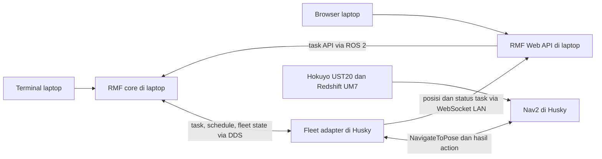

# Open-RMF → Nav2 untuk satu Husky A200 fisik

Repository ini berisi dua **snapshot**, bukan workspace yang otomatis
terpasang di laptop atau robot. Jalur fisik menggunakan paket
`brin_husky_distributed` pada kedua snapshot.



Identitas fisik snapshot: `/a200_1060`, nama RMF `husky_0`, fleet `HuskyA200`,
dan lantai `L1`. Semua proses fisik memakai waktu nyata. Laptop menjalankan
satu schedule, dispatcher, building map server, dan pengumum profil. Robot
mempertahankan driver, sensor, lokalisasi, Nav2, bridge fisik yang sudah ada,
preflight, dan satu adapter onboard.

Mulai dari [panduan dua komputer](laptop/src/brin_husky_distributed/README.md).
Untuk browser gunakan [panduan Web fisik](laptop/src/brin_husky_distributed/WEB.md).
Panduan Nav2/sensor robot ada pada [husky_nav2](husky/src/husky_nav2/README.md).

Untuk alur GitHub dan deployment per komputer, gunakan
[panduan deployment repository](docs/DEPLOYMENT.md). Skrip
`tools/integration.bash` membangun target terpisah tanpa menimpa workspace lama.
Bukti runtime serta batas hasil ada di [status implementasi](IMPLEMENTATION_STATUS.md).

## Build snapshot terpisah

Jangan membangun kedua `src` dalam satu pencarian colcon: nama paketnya sama.
Dari root repository, setelah overlay Humble/Clearpath/RMF di-source:

```bash
colcon --log-base laptop/log build --base-paths laptop/src \
  --build-base laptop/build --install-base laptop/install --symlink-install \
  --packages-select brin_rmf_maps brin_husky_fleet_adapter brin_husky_hardware brin_husky_distributed
source laptop/install/local_setup.bash
```

Pemeriksaan snapshot Husky di laptop membuktikan kompatibilitas source,
bukan instalasi di robot. Deployment memerlukan persetujuan terpisah; build
di robot memakai overlay robot sendiri. Jangan menyalin `build`, `install`,
atau `log` antar komputer. Audit SSH dan uji komunikasi sementara telah
dilakukan atas persetujuan operator; deployment source repository ke workspace
aktif robot dan push GitHub belum dilakukan.

## Batas verifikasi

Source kedua sistem dibandingkan sebelum integrasi Web ditambahkan.
Parameter sensor, TF, EKF, kecepatan, controller, dan keselamatan robot
dipertahankan. Snapshot tidak membuktikan driver UM7 sedang hidup atau peta
simulasi cocok dengan ruangan fisik: periksa IMU, scan, pose AMCL, dan piksel
peta di lokasi. `profile_info` membantu mencocokkan aset dan memilih tujuan.
Preflight memeriksa profil, geometri peta, kesegaran data/TF, controller,
action, dan RMF core.

Penerimaan operasi memerlukan bukti gerak Nav2, task terminal, pembatalan
ketika bergerak, dan task browser pada robot fisik.
