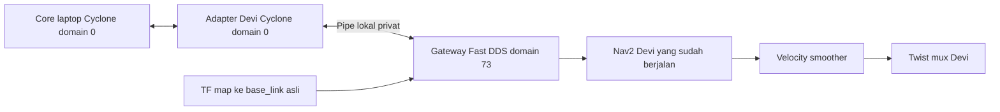

# Devi — urutan menjalankan Nav2 dan adapter ke core RMF bersama Husky

Workspace integrasi: **`/home/devi/rmf-integration`**.
Underlay Nav2/driver: **`/home/devi/devi_ws`**.
Robot: `devi@192.168.0.237`, hostname `devi-nuc`, ROS 2 Humble.
Panduan pusat: [README laptop](../laptop/readme.md).

Laptop menjalankan **satu core RMF untuk dua fleet**: `HuskyA200/husky_0`
dan `Devi/devi`. Devi menjalankan satu adapter onboard dan menggunakan
Nav2 yang sudah bekerja. Lantai bersama `L1`, profil RMF **`gedungWS_0`**.
Adapter Devi saat ini hanya mendukung profil itu; tidak ada argumen
`traffic_profile` pada `tools/devi.bash`.

**Status saat panduan ditulis:** build, pembacaan sensor/TF, koneksi schedule,
dan service action Nav2 tanpa goal sudah diuji. Kalibrasi peta dan penerimaan
fisik belum selesai, sehingga konfigurasi bawaan masih menolak dispatch.
Ikuti langkah 1–5 untuk pemeriksaan sekarang. Preflight pada langkah 7 dapat
dipakai untuk melihat alasan penolakan. Aktivasi langkah 8 baru dilanjutkan
setelah syarat langkah 6 selesai dan preflight diterima.

## 1. Kenali terminal dan domain

| Terminal | Isi | Domain/middleware |
| --- | --- | --- |
| **L1 di laptop** | Satu core, tetap hidup sepanjang sesi | `0`, Cyclone DDS |
| **D0 di Devi** | Perintah ROS manual untuk memeriksa Nav2 dan sensor | `73`, Fast DDS |
| **D1 di Devi** | Bringup/Nav2 yang sudah bekerja, hanya jika belum berjalan | `73`, Fast DDS |
| **D2 di Devi** | Build, profil, inspect, link-check dan preflight | Helper menyiapkan RMF `0`/Cyclone dan worker Nav2 `73`/Fast DDS |
| **D3 di Devi** | Satu adapter, tetap hidup saat operasi | Sama seperti D2 |
| **L2 di laptop** | Verifikasi dua fleet, task dan cancel | `0`, Cyclone DDS |

Urutan: **L1 core → D0 periksa proses → D1 bila perlu → D0 verifikasi Nav2
→ D2 inspect/link-check → kalibrasi dan penerimaan → D2 preflight → D3
adapter → L2 verifikasi registrasi → task dari laptop**.
Husky mempunyai Nav2 dan adapter sendiri; jangan menjalankan core di Devi.



RMF dan Nav2 dipisahkan menjadi dua proses agar masing-masing memakai
middleware yang sudah diuji. Konversi koordinat dilakukan di adapter;
tidak ada relay TF atau perubahan domain Nav2. Perintah helper di D2/D3
tidak mengubah environment shell D0, `.bashrc`, service atau jaringan.

## 2. Persiapan D0 dan D2

Di D2, periksa source dan file underlay yang diaudit:

```bash
cd /home/devi/rmf-integration
git status --short
git rev-parse HEAD
python3 devi/verify_underlay.py
```

Pada setup awal, verifier harus memuat `files_checked: 10` dan
`all_original_files_unchanged: true`. Jika underlay kemudian diubah melalui
pekerjaan yang disetujui, tinjau perbedaannya dan perbarui bukti audit;
jangan menyalin snapshot `devi/reference` kembali ke `devi_ws`.
Bandingkan versi integrasi dengan laptop dan Husky.

Runtime berikut sudah dipasang operator saat setup 2 November 2026:
`ros-humble-rmf-fleet-adapter-python`, `ros-humble-rmf-fleet-msgs`,
`ros-humble-rmf-task-msgs`, dan `ros-humble-rmw-cyclonedds-cpp`.
Bila source integrasi belum dibangun atau kode paket berubah, jalankan di D2:

```bash
cd /home/devi/rmf-integration
bash tools/devi.bash build
bash tools/devi.bash profile
```

Build harus berhasil untuk `brin_devi_fleet_adapter`. Artefak berada di
`devi/build`, `devi/install`, `devi/log`. Perubahan README saja tidak memerlukan
build ulang. Jangan membangun ulang `devi_ws` untuk menjalankan adapter ini.

Untuk **D0 dan D1**, gunakan terminal baru dengan environment Nav2 berikut.
Untuk LAN biasa yang telah diaudit, discovery server di-unset hanya pada
terminal ini; jika memakai server khusus, tinjau dahulu.

```bash
source /opt/ros/humble/setup.bash
source /home/devi/devi_ws/install/local_setup.bash
export ROS_DOMAIN_ID=73 ROS_LOCALHOST_ONLY=0 RMW_IMPLEMENTATION=rmw_fastrtps_cpp
unset ROS_DISCOVERY_SERVER
cd /home/devi/devi_ws
```

Jangan memakai environment domain `0` laptop untuk menjalankan bringup Devi.
Di D2/D3 cukup gunakan helper dari root repository; biarkan middleware
RMF bawaan Cyclone, tanpa override `DEVI_RMF_RMW` untuk sesi operasional.

## 3. D0/D1 — gunakan Nav2 yang sudah berjalan

Di D0 setelah environment bagian 2 disiapkan, lihat proses yang tersedia:

```bash
timeout 8s ros2 node list --no-daemon --spin-time 3
ros2 pkg prefix devi_navigation
```

Jika bringup, AMCL, map server dan Nav2 yang benar sudah aktif, **gunakan
proses itu dan lewati perintah start D1**. D1 dapat berupa terminal bringup
yang sudah ada; jangan menambah driver, EKF, map server atau Nav2 kedua.

Hanya jika bringup belum berjalan dan operator menyetujui aktivasi, gunakan
terminal D1 dengan environment bagian 2:

```bash
DEVI_NAV_MAP="$(ros2 pkg prefix devi_navigation)/share/devi_navigation/maps/workshop_l_1.yaml"
test -f "$DEVI_NAV_MAP"
ros2 launch devi_bringup bringup.launch.py \
  localization:=amcl navigation:=true map:="$DEVI_NAV_MAP" rviz:=true
```

Biarkan D1 hidup. Perintah memakai peta Devi yang sudah diaudit,
`workshop_l_1.yaml`. Bringup pada snapshot mencakup sensor, lokalisasi dan
Nav2; include actuation/safety/mission tidak diaktifkan di file tersebut.
Driver motor dan kesiapan keselamatan tetap mengikuti prosedur hardware
Devi yang sudah bekerja. Jangan mengaktifkan include itu lewat panduan ini.

Jika sesi dijalankan tanpa layar, `rviz:=false` dapat dipakai dan observasi
dilakukan lewat RViz Devi yang sudah disiapkan operator pada domain `73`.
Gunakan **Fixed Frame `map`**, scan `/devi/rplidar/scan_filtered`, dan
`2D Pose Estimate` menuju `/initialpose` bila initial pose perlu diperbaiki.
RViz Husky di laptop mengirim initial pose ke Husky, bukan ke Devi.

## 4. D0 — pastikan Nav2 benar sebelum memeriksa RMF

Dengan D1/bringup lama tetap hidup, jalankan di D0:

```bash
timeout 8s ros2 lifecycle get /bt_navigator
timeout 8s ros2 lifecycle get /controller_server
timeout 8s ros2 lifecycle get /planner_server
timeout 8s ros2 param get /bt_navigator use_sim_time
timeout 8s ros2 param get /map_server yaml_filename
timeout 8s ros2 action list -t
```

Lifecycle harus `active [3]`, `use_sim_time` harus `False`, map server harus
memakai `workshop_l_1.yaml`, dan action harus memuat
`/navigate_to_pose [nav2_msgs/action/NavigateToPose]`. Amati scan, peta dan
pose di RViz Devi; pose awal AMCL tidak otomatis membuktikan posisi fisik benar.

Interface yang dipakai adapter:

| Data/perintah | Interface Nav2 asli pada domain `73` |
| --- | --- |
| Peta / pose | `/map`, `/amcl_pose` |
| Scan | `/devi/rplidar/scan_filtered` |
| Odometri | `/odometry/filtered` |
| TF lokalisasi | `map → odom → base_link` pada `/tf` dan `/tf_static` |
| Navigasi | `/navigate_to_pose` |
| Jalur kecepatan | `/devi/cmd_vel_nav_raw` → smoother → `/devi/cmd_vel_nav` → twist mux |

Jika tidak sesuai, selesaikan pemeriksaan Nav2 melalui prosedur robot.
Jangan memindahkan Nav2 ke domain `0` atau mengganti TF/peta untuk sekadar
membuat pemeriksaan RMF terlihat lulus.

## 5. D2 — periksa koneksi ke satu core laptop tanpa gerak

Minta operator laptop menjalankan **langkah 3 README laptop** terlebih dahulu:
satu core `traffic_profile:=gedungWS_0`, Cyclone DDS/domain `0`, waktu nyata.
Jangan menyalin perintah start core ke Devi. Jika core untuk Husky sudah
aktif pada profil yang sama, gunakan core tersebut.

Dengan L1 dan Nav2 tetap hidup, di D2:

```bash
cd /home/devi/rmf-integration
bash tools/devi.bash profile
bash tools/devi.bash inspect
bash tools/devi.bash link-check
```

Digest profil yang harus sama dengan laptop/Husky:

```text
ff44d7a33b01732e6c277b523c40ae5c7ef6c011dab83b259e5db44daef9f221
```

Hasil `inspect` yang siap pada sisi Nav2: `nav2_ready: true`,
`nav2_errors: []`, lima lifecycle aktif (`3`), pose terbaca, dan
`received_profile_digest` cocok. Exit `0` pada mode inspect hanya memeriksa
kesiapan Nav2. Baca `accepted` dan `errors` untuk kesiapan integrasi penuh.
Geometri `/map` diperiksa, tetapi belum seluruh piksel peta aktif.

Hasil `link-check` harus exit `0` dan memuat:

```json
{
  "native_adapter_connected_to_schedule": true,
  "nav2_action_available": true,
  "nav2_action_service_responded_to_unknown_goal": true,
  "nav2_context_domain": 73,
  "rmf_observer_context_domain": 0,
  "nav2_rmw": "rmw_fastrtps_cpp",
  "rmf_rmw": "rmw_cyclonedds_cpp",
  "robot_registered": false,
  "goals_sent": 0
}
```

Request service memakai UUID goal yang tidak ada, bukan mengirim goal atau
cancel. Ketiga pemeriksaan ini selesai sendiri dan tidak mendaftarkan fleet.
Hasil koneksi yang lulus belum memberi izin mengaktifkan adapter fisik.

## 6. Syarat sebelum dispatch — kalibrasi dan penerimaan fisik

Konfigurasi [devi.yaml](src/brin_devi_fleet_adapter/config/devi.yaml) masih
memuat transformasi `null`, `map_alignment.confirmed: false`,
`commissioning.footprint_confirmed: false`, dan
`commissioning.operation_accepted: false`. Inilah titik berhenti konfigurasi
setup saat ini. Jangan mengisi transformasi nol atau mengubah flag menjadi
`true` tanpa hasil pengukuran/penerimaan.

Peta Nav2 Devi `workshop_l_1` mempunyai origin `[-4.59, -18.5, 0]`, sedangkan
peta RMF `gedungWS_0_rmf` origin `[0, -33.65, 0]`; gambarnya juga berbeda.
Selisih origin saja tidak membuktikan hubungan koordinat. Langkah yang harus
diselesaikan operator sebelum melanjutkan:

1. Ukur pasangan koordinat untuk beberapa titik fisik yang sama pada peta
   Devi dan graph RMF, sedikitnya tiga titik yang tersebar dan tidak segaris.
   Tentukan translasi x/y dan rotasi yaw, lalu periksa residual pada titik lain.
2. Tinjau hasil kalibrasi sebelum mengisi `map_alignment.x`, `.y`, `.yaw`
   dalam meter/radian dan mengonfirmasi kalibrasi di `devi.yaml`.
3. Ukur footprint fisik. Polygon Nav2 lama masih bertanda placeholder;
   radius RMF `0.79 m` hanya melingkupi placeholder tersebut. Tinjau perubahan
   yang diperlukan pada konfigurasi robot secara terpisah sebelum konfirmasi
   `footprint_confirmed`; jangan menyalin geometri Husky.
4. Dengan adapter berhenti, operator menerima uji Nav2 pendek, pembatalan,
   kendali manual dan penghentian fisik. Setelah diterima dan dicatat,
   `operation_accepted` dapat dikonfirmasi melalui perubahan yang ditinjau.
5. Periksa task lama/tertunda pada core sebelum registrasi adapter.

Rumus adapter adalah `pose_RMF = R(yaw) × pose_Nav2 + [x, y]`; goal memakai
transformasi kebalikannya. Konversi ini tidak menerbitkan atau mengubah TF.
Kesamaan digest bundle RMF belum memverifikasi kalibrasi tersebut.

## 7. D2 — preflight tanpa dispatch

Dengan core L1 dan Nav2 aktif, jalankan di D2:

```bash
cd /home/devi/rmf-integration
bash tools/devi.bash preflight
```

Syarat lanjut adalah JSON **`accepted: true`, `errors: []`**. Perintah
selesai sendiri; Nav2 dan core tetap berjalan. Exit code `ros2 launch`
sendiri bukan bukti lulus. Dengan konfigurasi setup sekarang, hasil yang
diharapkan masih `accepted: false` dan error kalibrasi belum dikonfirmasi.
Kembali ke langkah 6 bila itu terjadi; jangan melewati pemeriksaan.

## 8. D3 — satu adapter Devi, lalu verifikasi dari laptop

Hanya setelah langkah 6 diterima dan langkah 7 lulus, buka D3:

```bash
cd /home/devi/rmf-integration
BRIN_ENABLE_DISPATCH=1 bash tools/devi.bash adapter
```

Biarkan D3 hidup. Helper mengulangi preflight dan baru memulai adapter bila
diterima. Tidak ada Nav2, driver, map server atau core baru yang dimulai.
Log registrasi yang diharapkan adalah `Registered devi in Devi`.

Minta operator laptop memeriksa di **L2 dengan environment domain `0`**:

```bash
timeout 20s ros2 topic echo /fleet_states rmf_fleet_msgs/msg/FleetState
timeout 8s ros2 param get /brin_devi_fleet_adapter use_sim_time
```

Harus ada fleet `Devi` berisi robot `devi`, level `L1`, pose RMF yang masuk
akal, task awal kosong, dan waktu simulasi `False`. Untuk sesi dua robot,
stream yang sama juga harus memuat fleet `HuskyA200` dengan `husky_0`.
Pesan kedua fleet terpisah; `--once` dapat hanya mengambil salah satunya.
Exit `124` monitor setelah 20 detik adalah akhir pengamatan.

D0 memakai domain Nav2 `73`, sehingga bukan terminal untuk mencari
`/fleet_states` RMF domain `0`. RViz/sensor Devi tetap diperiksa lewat D0/D1.
Kedua adapter menunggu task RMF aktif; tinjau juga antrean lama dan pastikan
kedua robot diam sebelum mengirim task pertama.

### Task dan cancel

Task dikirim dari **L2 laptop**, mengikuti bagian 7.2 README laptop:
request bertarget `fleet: Devi`, `robot: devi`, kategori Patrol satu putaran,
ke waypoint `gedungWS_0` yang disetujui. Siapkan pengamatan respons di L5.
CLI lama `brin_husky_hardware send_task` tidak menerima `--robot devi`;
jangan menambahkan argumen yang tidak tersedia atau memakai dispatch tanpa
target robot. CLI cancel dari laptop mendukung ID task kedua fleet.

Catat ID task/booking, bukan request ID. Amati perpindahan fisik, feedback,
hasil Nav2 dan status RMF. Uji cancel dilakukan terpisah dengan operator;
respons API atau task ID kosong belum membuktikan robot sudah berhenti.
Uji Husky dan Devi secara individu dahulu sebelum penerimaan traffic bersama.

Jika berpindah ke Web, ikuti bagian 9 README laptop. Setelah kedua robot
diam dan adapter lama berhenti, D3 menggunakan perintah berikut pada sesi
core/API pengganti yang telah siap:

```bash
cd /home/devi/rmf-integration
BRIN_ENABLE_DISPATCH=1 bash tools/devi.bash adapter \
  server_uri:=ws://192.168.0.218:8000/_internal
```

Preflight tetap berlaku. Web/telemetry Devi belum diuji end-to-end.

## 9. Urutan berhenti

1. Hentikan request baru dari laptop. Selesaikan/batalkan task yang benar
   dan konfirmasi Devi serta Husky diam bersama operator masing-masing.
2. Hentikan D3 adapter Devi dan H4 adapter Husky sebelum core. Pastikan
   goal Nav2 tidak tetap berjalan; Ctrl-C/putus DDS bukan E-stop.
3. Hentikan D1 hanya jika bringup itu memang dimulai untuk sesi ini dan
   operator menghendakinya. Pertahankan service/driver platform lain.
4. Operator laptop menghentikan dashboard/API bila ada, lalu core L1 terakhir.

## 10. Jika pemeriksaan gagal

| Gejala | Langkah berikutnya |
| --- | --- |
| Nav2 tidak ditemukan | Periksa D0 memakai Fast DDS/domain `73` dan bringup D1 |
| `nav2_ready: false` | Baca `nav2_errors`; periksa scan, odometri, AMCL, TF, lifecycle dan map |
| Native schedule gagal / digest kosong | Pastikan satu core laptop `gedungWS_0` hidup dengan Cyclone/domain `0` |
| `Invalid ... ScheduleQuerySpacetime` | Gunakan pemisahan middleware bawaan helper; jangan menghubungkan native Fast DDS ke core Cyclone |
| `accepted: false` terkait alignment/commissioning | Selesaikan pengukuran dan penerimaan langkah 6 |
| `/fleet_states` tidak terlihat dari D0 | Periksa dari laptop L2 domain `0`, bukan domain Nav2 `73` |
| Fleet ada tetapi marker Devi belum ada | Verifikasi pose melalui `/fleet_states`; preset RViz laptop memakai sensor/TF Husky |
| Map/scan atau gerak tidak sesuai | Hentikan tahap gerak bersama operator; jangan menebak transformasi atau mengubah sensor/safety |

Rincian implementasi: lifecycle command berasal dari snapshot Husky commit
`a7cb39b1bc0fdb8a4c19007c36c3241d4239eb2a`, kemudian dipisah ke paket
`brin_devi_fleet_adapter` dengan gateway lokal dan konversi koordinat.
Goal memakai behavior tree bawaan Nav2 Devi. Responsive wait dan recovery
mundur otomatis adapter dinonaktifkan; stop nol melewati smoother dan twist
mux yang sudah ada. Nilai baterai/mekanis fleet masih perkiraan; battery
drain dan perjalanan charger otomatis dinonaktifkan. `ws_p0` bukan bukti
docking fisik, dan baterai Roboteq belum menjadi telemetry RMF.

[Hasil setup](SETUP_RESULT_2026-11-02.md) mencatat bukti dan batas pengujian.
`reference/devi_ws/src` adalah arsip baca saja, bukan source yang dibangun
atau otomatis dideploy ke underlay.
