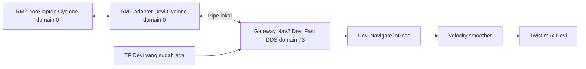

# Devi: Open-RMF di laptop, Nav2 dan adapter di robot

Workspace robot: `/home/devi/rmf-integration`. SSH: `devi@192.168.0.237`.
Nav2, lokalisasi, driver, sensor, dan twist mux tetap berasal dari
`/home/devi/devi_ws`. Paket integrasi baru adalah `brin_devi_fleet_adapter`;
nama robot RMF `devi`, fleet `Devi`, lantai `L1`.



Seperti Husky, laptop menjalankan satu schedule, dispatcher, building map
server, dan pengumum profil. Devi menjalankan satu adapter onboard setelah
preflight diterima. Tidak ada RMF core kedua di robot.

## Perbedaan dari Husky

| Bagian | Husky | Devi |
| --- | --- | --- |
| Underlay robot | Clearpath dan `ros2_ws` | `devi_ws/install/local_setup.bash` |
| Domain Nav2 | 0 | **73, tetap dipertahankan** |
| Domain RMF | 0 | 0 |
| NavigateToPose | `/a200_1060/navigate_to_pose` | `/navigate_to_pose` |
| Pose | TF bridge `husky_0/base_link` | Membaca TF `map → base_link` asli |
| Scan | Hokuyo namespaced | `/devi/rplidar/scan_filtered` |
| Odometri | Clearpath | `/odometry/filtered` |
| Peta aktif robot | `gedungWS_0_rmf` | `workshop_l_1` |
| Nav2 maksimum linear/angular | 0,5 m/s; 0,5 rad/s | 0,5 m/s; 0,8 rad/s |

Middleware dipisahkan melalui dua proses: native `rmf_adapter`, command
handle, dan pembacaan `/fleet_states` memakai Cyclone DDS/domain 0. Satu
gateway Python menggunakan Fast DDS/domain 73 untuk membaca Nav2 dan
meneruskan action. Gateway berkomunikasi melalui pipe lokal privat, tanpa
port TCP. Respons, feedback dan pembatalan tetap diproses pada thread command
handle; urutan lifecycle command Husky dipertahankan.
Worker dibuat dengan metode `spawn` agar middleware dipilih dalam interpreter
baru. Domain Nav2 ditetapkan eksplisit memakai
[API context Humble](https://github.com/ros2/rclpy/blob/humble/rclpy/rclpy/context.py).
Pemeriksaan transport native, pipe dan service Nav2 ada pada `link-check`.

Tidak ada domain bridge, relay TF, perubahan `~/.bashrc`, service autostart,
IP/interface, parameter sensor, controller, kecepatan Nav2, atau twist mux.
Core laptop dan native adapter menggunakan Cyclone DDS seperti Husky;
gateway memakai middleware yang sama dengan Nav2 Devi. Keduanya teruji.
Menghubungkan native Fast DDS langsung ke schedule Cyclone pernah merusak
deserialisasi query schedule pada uji sementara; karena itu jalur tersebut
tidak digunakan. `DEVI_RMF_RMW` adalah override diagnostik, bukan pengaturan
Nav2 atau pengganti jalur Cyclone yang sudah diuji.

## Build dan pemeriksaan tanpa gerak

Runtime RMF sudah dipasang operator pada 2 November 2026 dengan:

```bash
sudo apt-get install --no-install-recommends \
  ros-humble-rmf-fleet-adapter-python \
  ros-humble-rmf-fleet-msgs ros-humble-rmf-task-msgs \
  ros-humble-rmw-cyclonedds-cpp
```

Dari root repository di Devi:

```bash
cd ~/rmf-integration
bash tools/devi.bash build
bash tools/devi.bash profile
bash tools/devi.bash inspect
python3 devi/verify_underlay.py
```

Artefak build hanya ada di `devi/build`, `devi/install`, `devi/log`.
Jangan membangun semua snapshot dalam satu pencarian colcon. Untuk build
source di komputer lain, `DEVI_UNDERLAY` boleh menunjuk underlay Humble lokal;
ini bukan bukti instalasi atau kesiapan fisik Devi.

`inspect` membaca sensor, peta, TF dan lifecycle Nav2. Exit 0 berarti
`nav2_ready: true`; lihat `accepted` untuk status penerimaan integrasi penuh.
Pemeriksaan ini tidak membuka publisher kecepatan, mendaftarkan robot, atau
mengirim goal. Pemeriksaan `/map` membandingkan geometri, belum seluruh piksel.

Untuk uji koneksi, gunakan **satu** core di laptop. Perintah berikut hanya
dijalankan jika core belum aktif:

```bash
bash tools/integration.bash laptop core traffic_profile:=gedungWS_0
```

Di Devi:

```bash
bash tools/devi.bash link-check
bash tools/devi.bash inspect
bash tools/devi.bash preflight
```

`link-check` harus menunjukkan native adapter tersambung ke schedule,
action Nav2 tersedia, context Nav2 `73`, context observer RMF `0`, dan respons
service result untuk UUID yang tidak ada. Tidak ada goal dikirim atau
fleet/robot didaftarkan. `preflight` mengeluarkan JSON; penerimaan
memerlukan `accepted: true`, bukan sekadar exit code launch.

## Peta dan penerimaan operasi yang masih diperlukan

Peta robot `workshop_l_1` beresolusi 0,05 m dengan origin `[-4.59, -18.5, 0]`.
Peta RMF `gedungWS_0_rmf` memiliki origin `[0, -33.65, 0]` dan gambar berbeda.
Selisih origin saja **tidak cukup** untuk menyamakan dua hasil pemetaan.
Jangan mengganti Nav2 ke peta Husky atau memasang TF identitas sebagai jalan pintas.

Konfigurasi [devi.yaml](src/brin_devi_fleet_adapter/config/devi.yaml) menyimpan
transformasi rigid yang harus diukur dari titik fisik berkorespondensi:

```text
pose_RMF = R(yaw) * pose_Nav2 + [x, y]
goal_Nav2 = R(yaw)^-1 * (goal_RMF - [x, y])
```

Konversi hanya dilakukan di adapter. Tidak menerbitkan atau mengubah TF.
`map_alignment` sengaja belum dikonfirmasi dan nilai x/y/yaw masih null.
Periksa residual pada beberapa titik dan kecocokan graph sebelum mengisi
hasil kalibrasi. Graph dan digest `gedungWS_0` mengikuti laptop/Husky;
salinan `maps/gedungWS_0_fleet.yaml` dipertahankan untuk identitas bundle,
bukan konfigurasi fleet Devi yang dijalankan.

Footprint Nav2 asli masih ditandai **placeholder**. Lingkaran RMF 0,79 m
melingkupi polygon placeholder itu; ukuran fisik harus diukur dan ditinjau
sebelum `footprint_confirmed` diaktifkan. Nilai baterai/mekanis di konfigurasi
fleet adalah perkiraan untuk API planner; battery drain dan perjalanan
otomatis ke charger dinonaktifkan. `ws_p0` hanya referensi graph, bukan bukti
docking fisik tersedia. Telemetri baterai Roboteq belum diintegrasikan.

Aktivasi dispatch memerlukan kalibrasi peta, konfirmasi footprint, uji Nav2
dan pembatalan fisik dengan operator, serta `operation_accepted`. Setelah
semuanya diterima, operator dapat menjalankan:

```bash
BRIN_ENABLE_DISPATCH=1 bash tools/devi.bash adapter
```

Preflight selalu dijalankan lagi. Adapter menolak waktu simulasi, robot lain,
dan path tanpa task RMF aktif; responsive wait dan recovery mundur otomatis
dinonaktifkan. Goal memakai behavior tree bawaan Nav2 Devi yang sudah ada.
Pembatalan memakai action Nav2 dan stop nol melalui `/devi/cmd_vel_nav_raw`,
sehingga velocity smoother dan prioritas manual twist mux tetap berlaku.

## Source dan hasil setup

Lifecycle command berasal dari snapshot Husky commit
`a7cb39b1bc0fdb8a4c19007c36c3241d4239eb2a`, ditempatkan di paket bernama baru
agar tidak menimpa paket Husky. Konversi goal, gateway dua proses, launch dan
preflight khusus Devi ditambahkan. Tes lifecycle lama dipertahankan untuk
regresi pembatalan/penggantian goal; tes Devi memeriksa konversi koordinat
serta penolakan dispatch dan recovery yang belum diterima.

`reference/devi_ws/src` adalah arsip **baca saja**, bukan source yang dibangun
atau otomatis disalin kembali ke workspace asli. `reference/manifest.json`
mencatat SHA-256 sepuluh file konfigurasi/peta/URDF yang diaudit.
Hasil verifikasi ada di [SETUP_RESULT_2026-11-02.md](SETUP_RESULT_2026-11-02.md).
