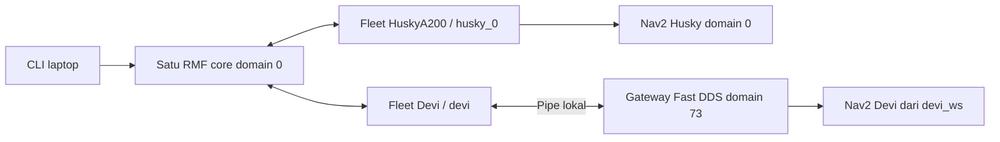

# Laptop — satu core Open-RMF untuk Husky dan Devi

Jalankan perintah laptop dari `/mnt/UbuntuData/rmf-integration`.
Panduan robot: [Husky](../husky/readme.md) dan [Devi](../devi/README.md).
Urutan di bawah memakai **satu profil `gedungWS_0`, satu core, dan dua fleet**.

| Komputer | Proses | Identitas dan domain |
| --- | --- | --- |
| Laptop `192.168.0.218` | Satu schedule, dispatcher, building map server, pengumum profil; RViz/CLI | Cyclone DDS, domain `0`, waktu nyata |
| Husky `192.168.0.120` | Sensor, Nav2, satu adapter onboard | Fleet `HuskyA200`, robot `husky_0`; domain `0` |
| Devi `192.168.0.237` | Nav2 dari `devi_ws`, satu adapter onboard dan gateway lokal | Fleet `Devi`, robot `devi`; RMF Cyclone/domain `0`, Nav2 Fast DDS/domain `73` |

Kedua robot dilaporkan pada lantai `L1`. Konfigurasi fleet Husky tetap hanya
berisi `husky_0`; Devi mempunyai konfigurasi fleet sendiri. Jangan menambahkan
Devi ke daftar robot Husky atau memulai core kedua untuk Devi.

Bringup Devi kini memakai map bersama `gedungWS_0_rmf.yaml`, footprint
**radius 0,55 m**, dan auto initial pose parkir pada setiap start:
**x=19.423, y=-28.2408, yaw=1.83415 rad** pada frame `map`.
Robot harus berada di lokasi dan arah parkir itu ketika bringup dimulai.
Penerimaan Nav2/cancel/manual/E-stop telah dikonfirmasi operator.
Registrasi dan tampilan baru tetap diperiksa saat service, core dan
lokalisasi sudah aktif; traffic fisik dua robot belum dinyatakan lulus.



## 1. Terminal dan urutan menjalankan sistem

Nama terminal menunjukkan jendela dan komputer, bukan urutan langkah.
`L1` pada nama terminal berbeda dari lantai RMF `L1`.

| Terminal | Fungsi |
| --- | --- |
| **L1** | Satu core RMF dan opsional RViz; dibiarkan hidup sampai akhir |
| **L2** | Pemeriksaan core/fleet dan node console task/waypoint/cancel |
| **L5** | Terminal observasi tambahan saat console task sedang terbuka |
| **L3 / L4** | API / dashboard Web, opsional setelah uji CLI diterima |
| **H0–H4** | Terminal Husky sesuai README Husky; **H4** untuk preflight lalu adapter |
| **D0** | Pemeriksaan ROS/Nav2 Devi pada domain `73` |
| **D1** | Service `devi_robot.service` untuk bringup Devi, otomatis setelah dipasang |
| **D2** | Pemeriksaan integrasi dan preflight Devi |
| **D3** | Tidak diperlukan pada startup baru; adapter dikelola supervisor Devi |

Urutan bersama: **service Devi aktif + auto pose → L1 core/RViz
→ registrasi Devi otomatis**. Husky tetap mengikuti urutan Nav2,
2D Pose Estimate, preflight dan H4 adapter. Verifikasi kedua fleet sebelum
mengirim task. Proses foreground sebelumnya tetap berjalan.

Seluruh proses fisik memakai waktu nyata. Aktivasi hardware/bridge dan uji
gerak mengikuti persetujuan operator setempat. Operator masing-masing robot
harus siap dengan kendali manual/E-stop. Putus SSH/DDS atau timeout CLI tidak
membuktikan goal Nav2 telah berhenti.

## 2. Persiapan laptop

Pastikan source/deployment ketiga komputer memakai versi integrasi yang
telah ditinjau. Dari root repository, periksa:

```bash
cd /mnt/UbuntuData/rmf-integration
git status --short
git rev-parse HEAD
```

Bandingkan versi dengan operator robot. Snapshot `laptop/src` dan `husky/src`
tidak otomatis terpasang di robot. Bila source integrasi laptop berubah dan
belum dibangun, jalankan sekali, lalu tunggu build berhasil:

```bash
bash tools/integration.bash laptop build
```

Perubahan README saja tidak memerlukan build ulang. Jangan membangun semua
folder snapshot dalam satu pencarian colcon atau menyalin hasil build ke robot.

Untuk **L2, L5 dan setiap terminal ROS manual laptop**, gunakan terminal baru
dan salin blok berikut. Ini environment terminal untuk LAN yang sudah diaudit;
jika memakai discovery server khusus, tinjau dahulu sebelum meng-unset-nya.

```bash
cd /mnt/UbuntuData/rmf-integration
source /opt/ros/humble/setup.bash
source /mnt/UbuntuData/clearpath_ws/install/local_setup.bash
source /mnt/UbuntuData/BRIN_ws/install/local_setup.bash
source /mnt/UbuntuData/rmf-integration/laptop/install/local_setup.bash
export ROS_DOMAIN_ID=0 ROS_LOCALHOST_ONLY=0 RMW_IMPLEMENTATION=rmw_cyclonedds_cpp
export CYCLONEDDS_URI="file://$PWD/laptop/src/brin_husky_distributed/config/cyclonedds_lan.xml"
export ROS_LOG_DIR="$PWD/laptop/log/ros"
unset ROS_DISCOVERY_SERVER
```

Export dilakukan setelah sourcing. Helper `integration.bash` hanya menyiapkan
anak prosesnya, bukan shell terminal lain. Periksa overlay dan profil di L2:

```bash
ros2 pkg prefix brin_husky_distributed
ros2 pkg prefix brin_husky_hardware
bash tools/integration.bash laptop profile traffic_profile:=gedungWS_0
timeout 8s ros2 node list --no-daemon --spin-time 3
```

Prefix kedua paket harus dari `.../rmf-integration/laptop/install/`.
Jika core sudah ada, gunakan core itu setelah profilnya dipastikan benar;
jangan menjalankan langkah 3 untuk membuat duplikat.

Digest `gedungWS_0` yang harus sama pada laptop, Husky dan Devi:

```text
a5c392a4a4446542b69b08d0bb44d8824e8ee081c955f7bc1cee3b795e4294be
```

Bringup baru Devi memuat map canonical yang sama dengan RMF dan Husky,
sehingga transformasi koordinatnya identitas. Posisi fisik tetap ditentukan
melalui pose parkir otomatis Devi; Husky tetap memakai initial pose manual. Konfigurasi setup lama
`workshop_l_1` disimpan sebagai konfigurasi dasar yang terkunci.

## 3. L1 — mulai tepat satu core RMF

Di L1, hanya jika core belum berjalan:

```bash
cd /mnt/UbuntuData/rmf-integration
bash tools/integration.bash laptop core traffic_profile:=gedungWS_0 rviz:=true
```

Biarkan L1 hidup untuk kedua robot. Nama paket launch masih
`brin_husky_distributed`, tetapi schedule/dispatcher di dalamnya dipakai
bersama oleh kedua fleet. Untuk sesi tanpa GUI, hilangkan `rviz:=true`.
Gunakan profil Cyclone DDS repository yang sudah disiapkan untuk kedua robot.

Profil Cyclone laptop kini mencantumkan peer Husky `192.168.0.120` dan
Devi `192.168.0.237`. Devi memakai profil RMF khusus dengan interface
`wlo1`, peer laptop/Husky dan ParticipantIndex `auto`. Pengaturan ini
disetujui operator untuk mengatasi discovery yang terputus setelah reboot;
domain dan middleware Nav2 masing-masing robot tetap sama.

Pada profil `gedungWS_0`, preset RViz bawaan baru adalah `devi_rmf.rviz`.
Map aktual Devi tampil pada **Shared gedungWS_0 map from Devi** (`/devi/map`).
Devi memakai auto initial pose dari `brin_devi_fleet_adapter/config/bringup.yaml` saat AMCL
aktif; posisi parkirnya harus sesuai pose yang dikonfigurasi. Tool **2D Pose
Estimate** bawaan mengarah ke `/devi/initialpose` untuk koreksi bila perlu.
Bridge lokal meneruskan koreksi manual ke AMCL pada domain `73`.

Untuk initial pose **Husky**, ubah **Tool Properties → 2D Pose Estimate
→ Topic → Value** ke `/a200_1060/initialpose`; kembalikan ke
`/devi/initialpose` sebelum klik untuk Devi. Preset `husky_rmf.rviz` lama
juga tetap tersedia melalui argumen `rviz_config:=/path/husky_rmf.rviz`.
Tool **2D Nav Goal** lama tetap untuk Husky; task Devi dikirim melalui RMF.

Di L2, periksa:

```bash
timeout 8s ros2 node list --no-daemon --spin-time 3
timeout 8s ros2 topic echo /brin_hardware/profile_digest std_msgs/msg/String \
  --once --qos-durability transient_local --qos-reliability reliable
timeout 8s ros2 param get /rmf_traffic_schedule_primary use_sim_time
```

Harus ada tepat satu dari setiap node berikut:
`rmf_traffic_schedule_primary`, `rmf_task_dispatcher`, `building_map_server`,
dan `brin_hardware_profile_announcer`. Digest harus cocok dengan bagian 2
dan `use_sim_time` harus `False`. Fleet belum harus muncul pada tahap ini.

## 4. Operator robot — Nav2 dan komunikasi tanpa gerak

**Husky:** ikuti persiapan environment, sensor dan Nav2 di README Husky.
Untuk sesi ini, gunakan bagian profil `gedungWS_0` pada awal README tersebut:
map Nav2 `gedungWS_0_rmf.yaml`, `traffic_profile:=gedungWS_0`, waktu nyata.
Contoh profil `banyak_simpangan`/`brin_0` pada bagian lama bukan pilihan sesi
dua robot ini. Hindari driver, map server atau Nav2 kedua.

Di H0 yang sudah memakai environment README Husky:

```bash
cd /home/husky/rmf-integration
bash tools/integration.bash husky profile traffic_profile:=gedungWS_0
timeout --signal=INT --kill-after=3s 25s python3 tools/native_adapter_check.py --wait 12
```

Hasil native check harus `native_adapter_connected_to_schedule: true` dan
exit `0`. Bila diperlukan, uji DDS pulang-pergi yang sudah tersedia dimulai
di **L2**, lalu responder **H0** dalam 30 detik:

```bash
# Laptop L2
timeout --signal=INT --kill-after=3s 35s python3 tools/dds_roundtrip.py \
  --role laptop --session dua_robot_husky_01 --timeout 30
```

```bash
# Husky H0, environment robot sudah disiapkan
timeout --signal=INT --kill-after=3s 25s python3 tools/dds_roundtrip.py \
  --role robot --session dua_robot_husky_01 --timeout 20
```

Kedua endpoint harus exit `0` dan `passed: true`.

**Devi:** pasang startup baru sekali menurut bagian 2–3
[README Devi](../devi/README.md). Service memuat driver/Nav2, bridge dan
supervisor adapter. Sesudah itu tidak perlu terminal adapter Devi terpisah.
Jangan menjalankan bringup lama atau adapter manual bersamaan dengan service.

Di D2, dengan service dan L1 hidup:

```bash
cd /home/devi/rmf-integration
systemctl status devi_robot.service --no-pager
python3 devi/verify_underlay.py
bash tools/devi.bash profile
bash tools/devi.bash inspect
```

Saat startup, AMCL menunggu data map/scan/odom. Sesudah lokalisasi otomatis,
`nav2_ready: true` dan `nav2_errors: []`
menunjukkan sisi Nav2 siap. `inspect` tidak mengirim goal.

## 5. Lokalisasi dan preflight kedua robot

Periksa peta, scan dan posisi fisik pada map baru. Operator sudah
mengonfirmasi footprint Devi radius 0,55 m serta uji Nav2, cancel, manual
dan E-stop. Bringup menghasilkan parameter runtime berdasarkan konfirmasi
itu, dengan kedua costmap dan profil RMF memakai radius yang sama.
Source parameter asli `devi_ws` tidak ditimpa.

**H4 — preflight Husky**, setelah persiapan hardware dan 2D Pose Estimate:

```bash
cd /home/husky/rmf-integration
bash tools/integration.bash husky preflight traffic_profile:=gedungWS_0
```

**D2 — pemeriksaan preflight Devi**, opsional untuk melihat hasil yang juga
terus diperiksa supervisor:

```bash
cd /home/devi/rmf-integration
bash tools/devi.bash preflight
```

Masing-masing harus menghasilkan **`accepted: true`, `errors: []`**.
Launch exit `0` sendiri tidak membuktikan penerimaan. Devi menunggu jika
lokalisasi, core, digest atau kedekatan graph belum memenuhi syarat.
Jika masih memakai konfigurasi lama/alignment belum dikonfirmasi, periksa
bahwa service baru memakai `devi/log/bringup_runtime/integration.yaml`.

## 6. Adapter dan verifikasi dua fleet

Husky tetap memulai satu adapter di H4 setelah preflight lulus:

```bash
cd /home/husky/rmf-integration
BRIN_ENABLE_DISPATCH=1 bash tools/integration.bash husky adapter traffic_profile:=gedungWS_0
```

Devi tidak memerlukan perintah adapter terpisah. Supervisor dalam service
menunggu preflight diterima, kemudian menjalankan satu adapter dan mencatat
**`Registered devi in Devi`**. Core boleh dinyalakan setelah robot boot.
Pose parkir otomatis diterapkan setiap bringup Devi dimulai ulang;
2D Pose Estimate hanya diperlukan untuk koreksi jika posisi awal berbeda.

Di L2, amati stream selama beberapa detik:

```bash
timeout 20s ros2 topic echo /fleet_states rmf_fleet_msgs/msg/FleetState
timeout 8s ros2 param get /brin_husky_fleet_adapter use_sim_time
timeout 8s ros2 param get /brin_devi_fleet_adapter use_sim_time
```

Harus terlihat **dua pesan fleet terpisah**: `HuskyA200/husky_0` dan
`Devi/devi`, lantai `L1`, pose sesuai, serta waktu `False`. `--once` tidak
cukup untuk membuktikan dua fleet; exit `124` adalah akhir durasi monitor.

Display **RMF fleet positions** (`/fleet_markers`) menampilkan kedua robot.
Devi memakai radius marker **0,55 m**. Preset baru menerima peta Devi lewat
`/devi/map`; grup **Devi sensors and Nav2** menerima laser, model robot,
kedua costmap, footprint, AMCL dan plan dari `/devi/viz/*` di domain `0`.
Grup **Husky sensors and Nav2** mempertahankan topic Husky yang sudah ada.
Tampilan marker Devi memakai pose aktual yang dilaporkan adapter.

Node `rmf_visualization_tf` menggabungkan TF pengamatan kedua robot pada
`/rmf_visualization/tf` dan `/rmf_visualization/tf_static`, khusus RViz.
Frame Devi mendapat awalan `devi/` sementara `map` tetap bersama. TF asli
controller tidak diubah. Raw laser, received plan dan jejak odometri Devi
tersedia sebagai display opsional; plan muncul ketika Nav2 menerbitkannya.
Rincian pemetaan topic ada di bagian 4 README Devi.

Untuk membuka ulang **hanya RViz** ketika core versi baru sudah aktif,
tutup jendela RViz lama, lalu:

```bash
cd /mnt/UbuntuData/rmf-integration
bash tools/integration.bash laptop view
```

`view` memakai visualizer/TF yang dikelola core dan tidak memulai core kedua.

## 7. L2 — node perintah untuk robot tertentu atau bidding RMF

Node baru **`brin_rmf_task_client`** berjalan di laptop sebagai executable
`brin_husky_distributed/task_client`. Core L1 tetap satu; terminal L2 menjadi
console task. Node ini hanya berkomunikasi melalui task API RMF/domain `0`,
bukan langsung ke action Nav2 atau motor.

Setelah pembaruan kode ini, jalankan build laptop sekali sebelum memakai
entry point baru:

```bash
cd /mnt/UbuntuData/rmf-integration
bash tools/integration.bash laptop build
```

Core dan adapter yang sudah diterima tetap mengikuti bagian 3–6. Pengiriman
request dapat menggerakkan robot. Untuk uji awal, kirim satu task per robot
terlebih dahulu, dengan tujuan yang disetujui operator.

### 7.1 Daftar waypoint dan preview tanpa mengirim task

```bash
bash tools/integration.bash laptop task --list-waypoints
bash tools/integration.bash laptop task --robot devi --places ws_p1 --dry-run
bash tools/integration.bash laptop task --bid --places ws_p1 --dry-run
```

Daftar dibaca dari graph profil, lengkap dengan lantai dan koordinat.
`--dry-run` menampilkan payload dan `request_published: false`; kedua mode
ini tidak membuat context/publisher ROS. Profil bawaan adalah `gedungWS_0`.
Untuk sesi profil lain, gunakan `--traffic-profile NAMA_PROFIL` yang sama
dengan core; node menolak pengiriman jika digest profil aktif berbeda.
Devi saat ini tetap hanya diterima untuk profil `gedungWS_0`.

### 7.2 Console interaktif: pilih robot/bidding dan waypoint

Buka L2 dan jalankan:

```bash
cd /mnt/UbuntuData/rmf-integration
bash tools/integration.bash laptop task
```

Urutan menu:

1. Ketik `devi` atau `husky_0` untuk memilih robot, atau `bid` agar RMF
   memilih fleet/robot melalui bidding bawaan.
2. Pilih satu atau beberapa waypoint dengan nama atau nomor daftar yang
   ditampilkan, dipisahkan spasi. Nama waypoint yang mengandung spasi dapat
   ditulis dengan tanda kutip.
3. Periksa payload tujuan dan target, lalu ketik `y` untuk mengirim.
4. Baca respons, ID task/booking, dan hasil alokasi. Console kembali ke menu.
5. Ketik `cancel` untuk membatalkan booking yang sudah dialokasikan, atau
   `q` untuk keluar dari console tanpa menghentikan core dan adapter.

Console tetap memproses ROS saat menunggu input. Profil harus cocok dan
robot target harus terlihat pada `/fleet_states` yang baru diterima sebelum
request dikirim. Jika Devi belum lolos preflight/registrasi, memilih Devi
akan ditolak sebelum publikasi; menu tidak melewati commissioning.

### 7.3 Perintah langsung untuk robot tertentu

Pakai salah satu perintah sesuai robot yang ingin diperintah:

```bash
# Fleet Devi / robot devi
bash tools/integration.bash laptop task --robot devi --places ws_p1
```

```bash
# Fleet HuskyA200 / robot husky_0
bash tools/integration.bash laptop task --robot husky_0 --places ws_p1
```

Nama fleet diambil dari `config/task_targets.yaml` pada paket
`brin_husky_distributed`: `devi → Devi`, `husky_0 → HuskyA200`.
Payload `robot_task_request` menargetkan pasangan tersebut. Tidak ada
bidding antar-robot pada mode ini; perencanaan dan penjadwalan tetap oleh RMF.
`ws_p1` adalah contoh waypoint graph, bukan pernyataan lokasi itu aman.

Untuk beberapa tujuan atau beberapa putaran Patrol:

```bash
bash tools/integration.bash laptop task --robot devi --places ws_p1 ws_p2 --rounds 2
```

### 7.4 Bidding bawaan: RMF memilih robot

```bash
bash tools/integration.bash laptop task --bid --places ws_p1
```

Mode ini mengirim `dispatch_task_request` **tanpa target fleet/robot**.
Dispatcher meminta bid dari fleet yang mampu menangani task, lalu planner
RMF menghitung alokasi. Client tidak membuat pemilih "robot terdekat" sendiri.
Semua fleet yang memenuhi syarat di core dapat ikut, bukan hanya dua nama
pada inventory console. Jika hanya Husky yang sudah terdaftar/siap, Devi
belum menjadi peserta yang tersedia.

Client menunggu `/dispatch_states` setelah API menerima request. Output
`allocation` menampilkan fleet dan robot yang dipilih setelah status
`dispatched`; `failed_or_canceled` memuat kegagalan alokasi, termasuk tidak
ada bid yang diterima. Nama robot pada hasil dispatcher adalah robot yang
**diharapkan** menjalankan task; konfirmasi pelaksanaan melalui state fleet.
Core saat ini memakai bidding window 2 detik dan evaluator QuickestFinish
bawaan dispatcher, tanpa perubahan algoritme oleh client.

### 7.5 Respons, timeout dan cancel

Node mencocokkan respons dengan request ID, lalu menampilkan `task_id`
dari `state.booking.id`. Pada perintah noninteraktif, exit code berarti:

| Exit code | Arti |
| --- | --- |
| `0` | API menerima task/cancel; untuk bidding, dispatcher juga sudah mengonfirmasi alokasi |
| `1` | API menolak atau bidding gagal/dibatalkan |
| `2` | Validasi/readiness gagal, respons timeout, atau alokasi masih pending |

Pada timeout setelah request dikirim, hasilnya bisa belum diketahui.
Jika `assignment_pending: true`, simpan `task_id` dan periksa `/dispatch_states`
sebelum mengambil tindakan berikutnya. Node tidak mengirim ulang otomatis.
History publisher request dibuang setelah transaksi agar menu yang terus
hidup tidak menyimpan perintah lama untuk adapter yang baru tersambung.

Batas waktu default 30 detik mencakup pemeriksaan readiness, respons API
serta alokasi bidding. Contoh menggantinya:

```bash
bash tools/integration.bash laptop task --bid --places ws_p1 --timeout 60
```

Untuk membatalkan task yang sudah dialokasikan, gunakan ID booking dari
hasil node, bukan `request_id`:

```bash
read -r -p 'ID task/booking yang akan dibatalkan: ' RMF_TASK_ID
bash tools/integration.bash laptop task --cancel "$RMF_TASK_ID"
```

Cancel berlaku untuk kedua fleet dan tidak memerlukan pilihan profil/robot.
Keluar dari console atau Ctrl-C tidak membatalkan task yang sudah dikirim.
Respons sukses bukan bukti gerak sudah berhenti atau task sudah selesai;
output selalu membedakan penerimaan request dari penyelesaian fisik.
Amati robot, hasil Nav2 dan state RMF bersama operator.

Untuk observasi tambahan di L5 yang sudah memakai environment bagian 2:

```bash
ros2 topic echo /fleet_states rmf_fleet_msgs/msg/FleetState
```

CLI lama `ros2 run brin_husky_hardware send_task` tetap tersedia untuk Husky
serta cancel berdasarkan booking ID. Gunakan client baru untuk task Devi
atau pemilihan bidding yang eksplisit; JSON manual tidak lagi diperlukan.
Referensi protokol: [dispatcher Humble](https://github.com/open-rmf/rmf_ros2/blob/humble/rmf_task_ros2/src/rmf_task_ros2/Dispatcher.cpp).

## 8. Menghentikan sesi

1. Hentikan pengiriman task, selesaikan/batalkan task aktif dan pastikan
   **kedua robot** diam bersama operatornya.
2. Hentikan adapter Husky di **H4**. Di Devi, setelah robot diam, gunakan
   `sudo systemctl stop devi_robot.service` untuk menghentikan bringup dan
   adapter bersama. Konfirmasi goal Nav2 berhenti sebelum menutup core.
3. Hentikan Nav2/sensor Husky yang dimulai untuk sesi ini bila diperlukan.
   Pertahankan service platform lain. Start service Devi berikutnya memakai
   kembali pose parkir otomatis.
4. Hentikan dashboard/API bila dipakai, kemudian **core L1 paling akhir**.
   RViz/visualizer dalam launch core ikut berhenti.

## 9. Web opsional setelah penerimaan CLI

[Panduan Web](src/brin_husky_distributed/WEB.md) memuat runtime yang sudah
dipasang. Web dua robot belum diuji end-to-end. Jika mengganti sesi core,
selesaikan/batalkan task dan pastikan kedua robot diam sebelum menghentikan
core lama. Pertahankan satu core. Urutannya: **service Devi otomatis saat boot → L3 API → L1 core
pengganti → adapter Husky → L4 dashboard**. Devi menunggu core sebelum
registrasi dan memakai koneksi Web bawaan. Profil tetap `gedungWS_0`.

### 9.1 L3 — menjalankan Web API di laptop

Setelah environment bagian 2 disiapkan, jalankan:

```bash
cd /mnt/UbuntuData/rmf-integration
export BRIN_LAPTOP_IP=192.168.0.218 RMF_WEB_ROOT=/mnt/UbuntuData/rmf-web
bash tools/integration.bash laptop web \
  web_root:="$RMF_WEB_ROOT" runtime_dir:="$PWD/laptop/log/rmf_web_real" \
  api_host:="$BRIN_LAPTOP_IP" public_url:="http://$BRIN_LAPTOP_IP:8000"
```

Biarkan L3 berjalan. Perintah `laptop web` menjalankan API pada port `8000`;
dashboard browser dijalankan terpisah pada langkah 9.4.

### 9.2 L1 — menjalankan satu core RMF untuk Web

```bash
cd /mnt/UbuntuData/rmf-integration
export BRIN_LAPTOP_IP=192.168.0.218
bash tools/integration.bash laptop core traffic_profile:=gedungWS_0 \
  server_uri:="ws://$BRIN_LAPTOP_IP:8000/_internal" rviz:=true
```

### 9.3 Robot — menghubungkan adapter ke Web API

L3 dan L1 tetap berjalan. Pada H4, tambahkan
`server_uri:=ws://192.168.0.218:8000/_internal`
pada perintah adapter Husky. **Devi kini memakai Web otomatis dari service
boot**, dengan default `ws://192.168.0.218:8000/_internal` pada
`brin_devi_fleet_adapter/config/bringup.yaml`. Jika service sudah aktif,
cukup tunggu registrasi dan koneksi Web; tidak perlu terminal adapter baru.

Di terminal Devi, periksa:

```bash
systemctl status devi_robot.service --no-pager -l
journalctl -b -u devi_robot.service -n 100 --no-pager -l
```

Jika masih memakai sesi Web foreground lama, parkirkan robot pada lokasi
auto pose, hentikan bringup manual dengan Ctrl-C dan tunggu selesai,
lalu jalankan sekali:

```bash
sudo systemctl enable --now devi_robot.service
```

Periksa lokalisasi otomatis Devi, log `Registered devi in Devi` dan
`BroadcastClient successfully connected`. Preflight tetap berlaku.
Client mencoba koneksi ulang jika API laptop belum tersedia. Penggantian
alamat dan pilihan mematikan Web dijelaskan dalam README Devi bagian 3.

### 9.4 L4 — menjalankan dashboard di terminal laptop baru

Gunakan launcher dashboard yang memakai runtime terpasang dan membuka port
`3000` untuk perangkat pada Wi-Fi/LAN yang sama:

```bash
cd /mnt/UbuntuData/rmf-integration
export BRIN_LAPTOP_IP=192.168.0.218 RMF_WEB_ROOT=/mnt/UbuntuData/rmf-web
bash tools/dashboard.bash lan
```

Tunggu `Compiled successfully!` dan biarkan terminal L4 tetap berjalan.
Launcher memakai `HOST=0.0.0.0`, API `http://192.168.0.218:8000`, dan
trajectory `ws://192.168.0.218:8006`. Kedua alamat backend harus menunjuk
laptop agar browser pada perangkat lain dapat menerima data. Untuk akses
dashboard hanya dari laptop, ganti `lan` dengan `local`.

### 9.5 Membuka dashboard melalui Google Chrome

Buka Google Chrome di laptop, HP, atau PC lain pada Wi-Fi/LAN yang sama,
lalu masukkan alamat berikut pada address bar:

**[http://192.168.0.218:3000](http://192.168.0.218:3000)**

`localhost` selalu menunjuk perangkat tempat browser dibuka. Alamat
`http://localhost:3000` tetap dapat dipakai pada laptop RMF. `0.0.0.0`
adalah alamat binding server, bukan alamat yang dibuka pada HP/PC lain.

Pilih lantai `L1`, lalu pasangan fleet/robot
yang benar: `HuskyA200/husky_0` atau `Devi/devi`. Gunakan Patrol satu putaran
ke tujuan yang sudah diterima. UI dan telemetry Web Devi masih perlu
diverifikasi di lapangan; keberhasilan CLI tidak membuktikan Web sudah lulus.

Jika Chrome menampilkan `ERR_CONNECTION_REFUSED`, periksa terminal L4:
dashboard harus masih berjalan pada port `3000`. API pada port `8000`
yang sudah aktif belum menunjukkan dashboard sudah dijalankan.

Pada 4 November 2026, akses dashboard dan `GET /fleets` dari komputer Devi
ke laptop telah diuji dan keduanya menghasilkan HTTP `200`. Handshake
WebSocket API (`8000`) dan trajectory (`8006`) menghasilkan HTTP `101`.
Uji ini memastikan akses LAN; uji perintah gerak melalui UI tetap dilakukan
bersama operator.

Devi tetap dikelola oleh service otomatis. Untuk menghentikan seluruh sesi,
ikuti bagian 8 setelah task selesai dan kedua robot diam.

### 9.6 Akses internet melalui domain dan login

Mode LAN pada bagian 9.4 belum menyediakan akses dari jaringan lain.
Untuk percobaan tanpa domain sendiri, gunakan **Protected Quick Tunnel**
Cloudflare. Browser menerima alamat HTTPS sementara `*.trycloudflare.com`
dan login dengan kode sekali pakai yang dikirim ke email yang diizinkan.
Tidak diperlukan akun Cloudflare bagi pengunjung.

Jalankan sekali untuk menyiapkan runtime dan build dashboard publik:

```bash
cd /mnt/UbuntuData/rmf-integration
export RMF_WEB_ROOT=/mnt/UbuntuData/rmf-web
bash tools/web_public.bash prepare
```

Perintah ini memerlukan Docker yang dapat dijalankan oleh pengguna laptop.
Runtime `cloudflared` diunduh dari rilis resmi dengan pemeriksaan SHA256,
dan image Nginx dipatok pada digest. Source dashboard publik disalin ke
`laptop/log/rmf_web_public/dashboard-source` lalu dibangun; checkout
`rmf-web`, dashboard LAN, API, core, serta robot tidak diganti.

Setelah API L3 dan core L1 aktif, buka terminal L5:

```bash
cd /mnt/UbuntuData/rmf-integration
export BRIN_LAPTOP_IP=192.168.0.218
read -r -p 'Email yang boleh masuk: ' BRIN_WEB_ALLOWED_EMAIL
bash tools/web_public.bash start "$BRIN_WEB_ALLOWED_EMAIL"
```

Gunakan email operator yang telah disetujui. Launcher menerima satu email
lengkap dan selalu mengaktifkan `--allowed-mail`; jika dukungan login tidak
tersedia, publikasi dibatalkan. Tunggu baris `Public dashboard: https://...`
dan buka alamat tersebut di Google Chrome pada HP/PC, termasuk dari
jaringan internet berbeda. Masukkan email yang diizinkan, buka email untuk
mengambil kode, lalu masukkan kode pada halaman login. Laptop, API, core,
dan terminal L5 harus tetap berjalan.

Dashboard, API `/api/`, dan WebSocket `/trajectory` memakai hostname yang
sama sehingga login melindungi ketiganya. Gateway lokal hanya mendengarkan
`127.0.0.1:8088`. URL gambar peta pada API dan Socket.IO diarahkan melalui
gateway, sehingga browser di luar LAN tidak perlu mengakses IP privat
laptop. Adapter robot tetap mengirim data ke
`ws://192.168.0.218:8000/_internal`; gateway publik memblokir endpoint ini.
Login tunnel membatasi akses seluruh dashboard; pengguna yang diizinkan
memiliki hak operasi dari akun dashboard bawaan, tanpa pemisahan peran.

Ctrl-C di L5 menghentikan tunnel dan container gateway milik launcher.
API, core, dashboard LAN, dan bringup robot tetap dikelola terminal/service
masing-masing. Alamat sementara berubah saat tunnel dibuat ulang dan
tidak memiliki jaminan uptime. Untuk domain tetap dan login Google,
gunakan Cloudflare Tunnel dengan Cloudflare Access setelah domain sendiri
tersedia.

Log tunnel: `laptop/log/rmf_web_public/tunnel.log`. Alamat sesi aktif:
`laptop/log/rmf_web_public/public_url.txt`.

Hasil pemeriksaan dan status penerimaan browser:
[WEB_ACCESS_RESULT_2026-11-04.md](WEB_ACCESS_RESULT_2026-11-04.md).

Referensi: [Protected Quick Tunnels](https://developers.cloudflare.com/tunnel/get-started/quick-tunnels/)
dan [Cloudflare Access untuk domain tetap](https://developers.cloudflare.com/cloudflare-one/access-controls/applications/http-apps/self-hosted-public-app/).

## 10. Jika tahap tidak lulus

| Gejala | Pemeriksaan berikutnya |
| --- | --- |
| Core ganda | Identifikasi sesi pemiliknya; pertahankan tepat satu core |
| Digest berbeda | Cocokkan source/aset `gedungWS_0`; jangan memaksa preflight |
| Devi `nav2_ready: true`, tetapi `accepted: false` | Baca `errors`; periksa core, digest dan graph; pastikan config runtime baru dipakai |
| Native schedule gagal / `Invalid ... ScheduleQuerySpacetime` | Pertahankan Cyclone pada core/native RMF; gateway Nav2 Devi tetap Fast DDS |
| Hanya satu fleet di `/fleet_states` | Periksa preflight dan log adapter robot yang belum terdaftar |
| Sensor Devi tidak terlihat di laptop | Relay `devi_visualization_bridge`, topic `/devi/viz/*`, grup Devi dan TF `/rmf_visualization/tf*` |
| Request timeout atau ditolak | Simpan respons, periksa target, waypoint, antrean dan ID task sebelum retry |
| Scan/peta atau gerak tidak sesuai | Hentikan tahap gerak bersama operator; jangan menebak TF atau mengganti parameter robot |

Rincian konfigurasi yang dipertahankan: [profil gedungWS](../docs/GEDUNGWS_0_2026-10-30.md),
[footprint Husky](../docs/FOOTPRINT_INFLATION_2026-11-02.md),
[kecepatan Husky](../docs/SPEED_UPDATE_2026-10-29.md),
dan [hasil setup Devi](../devi/SETUP_RESULT_2026-11-02.md).
