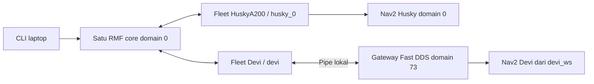

# Laptop — satu core Open-RMF untuk Husky dan Devi

Jalankan perintah laptop dari `/mnt/UbuntuData/rmf-integration`.
Panduan robot: [Husky](../husky/readme.md) dan [Devi](../devi/README.md).
Urutan di bawah memakai **satu profil `gedungWS_0`, satu core, dan dua fleet**.

| Komputer | Proses | Identitas dan domain |
| --- | --- | --- |
| Laptop `192.168.0.218` | Satu schedule, dispatcher, building map server, pengumum profil; RViz/CLI | Cyclone DDS, domain `0`, waktu nyata |
| Husky `192.168.0.120` | Sensor, Nav2, satu adapter onboard | Fleet `HuskyA200`, robot `husky_0`; domain `0` |
| Devi `192.168.0.237` | Nav2 dari `devi_ws`, satu adapter onboard dan gateway lokal | Fleet `Devi`, robot `devi`; RMF Cyclone/domain `0`, Nav2 Fast DDS/domain `73` |

Kedua robot dilaporkan pada lantai `L1`. Konfigurasi fleet Husky tetap hanya
berisi `husky_0`; Devi mempunyai konfigurasi fleet sendiri. Jangan menambahkan
Devi ke daftar robot Husky atau memulai core kedua untuk Devi.

**Status saat panduan ditulis:** koneksi RMF dan service Nav2 Devi telah
diuji tanpa gerak. Dispatch Devi masih terkunci karena kalibrasi peta,
konfirmasi footprint, dan penerimaan operasi belum selesai. Registrasi dua
robot, navigasi/task fisik, dan traffic bersama belum dinyatakan lulus.
Langkah komunikasi dapat dilakukan sekarang; langkah aktivasi adapter/task
hanya dilanjutkan setelah syarat masing-masing robot terpenuhi.



## 1. Terminal dan urutan menjalankan sistem

Nama terminal menunjukkan jendela dan komputer, bukan urutan langkah.
`L1` pada nama terminal berbeda dari lantai RMF `L1`.

| Terminal | Fungsi |
| --- | --- |
| **L1** | Satu core RMF dan opsional RViz; dibiarkan hidup sampai akhir |
| **L2** | Pemeriksaan core/fleet, pemilihan waypoint, task dan cancel |
| **L5** | Mengamati respons task API ketika mengirim task Devi |
| **L3 / L4** | API / dashboard Web, opsional setelah uji CLI diterima |
| **H0–H4** | Terminal Husky sesuai README Husky; **H4** untuk preflight lalu adapter |
| **D0** | Pemeriksaan ROS/Nav2 Devi pada domain `73` |
| **D1** | Bringup Devi yang sudah bekerja, jika belum berjalan |
| **D2** | Pemeriksaan integrasi dan preflight Devi |
| **D3** | Satu adapter Devi; dibiarkan hidup saat operasi |

Urutan bersama: **persiapan → L1 core → Nav2 kedua robot → pemeriksaan
komunikasi → penerimaan/kalibrasi → preflight masing-masing → H4 adapter
Husky → D3 adapter Devi → L2 verifikasi dua fleet → task satu robot dahulu**.
Proses foreground pada tahap sebelumnya tetap berjalan.

Seluruh proses fisik memakai waktu nyata. Aktivasi hardware/bridge dan uji
gerak mengikuti persetujuan operator setempat. Operator masing-masing robot
harus siap dengan kendali manual/E-stop. Putus SSH/DDS atau timeout CLI tidak
membuktikan goal Nav2 telah berhenti.

## 2. Persiapan laptop

Pastikan source/deployment ketiga komputer memakai versi integrasi yang
telah ditinjau. Dari root repository, periksa:

```bash
cd /mnt/UbuntuData/rmf-integration
git status --short
git rev-parse HEAD
```

Bandingkan versi dengan operator robot. Snapshot `laptop/src` dan `husky/src`
tidak otomatis terpasang di robot. Bila source integrasi laptop berubah dan
belum dibangun, jalankan sekali, lalu tunggu build berhasil:

```bash
bash tools/integration.bash laptop build
```

Perubahan README saja tidak memerlukan build ulang. Jangan membangun semua
folder snapshot dalam satu pencarian colcon atau menyalin hasil build ke robot.

Untuk **L2, L5 dan setiap terminal ROS manual laptop**, gunakan terminal baru
dan salin blok berikut. Ini environment terminal untuk LAN yang sudah diaudit;
jika memakai discovery server khusus, tinjau dahulu sebelum meng-unset-nya.

```bash
cd /mnt/UbuntuData/rmf-integration
source /opt/ros/humble/setup.bash
source /mnt/UbuntuData/clearpath_ws/install/local_setup.bash
source /mnt/UbuntuData/BRIN_ws/install/local_setup.bash
source /mnt/UbuntuData/rmf-integration/laptop/install/local_setup.bash
export ROS_DOMAIN_ID=0 ROS_LOCALHOST_ONLY=0 RMW_IMPLEMENTATION=rmw_cyclonedds_cpp
export CYCLONEDDS_URI="file://$PWD/laptop/src/brin_husky_distributed/config/cyclonedds_lan.xml"
export ROS_LOG_DIR="$PWD/laptop/log/ros"
unset ROS_DISCOVERY_SERVER
```

Export dilakukan setelah sourcing. Helper `integration.bash` hanya menyiapkan
anak prosesnya, bukan shell terminal lain. Periksa overlay dan profil di L2:

```bash
ros2 pkg prefix brin_husky_distributed
ros2 pkg prefix brin_husky_hardware
bash tools/integration.bash laptop profile traffic_profile:=gedungWS_0
timeout 8s ros2 node list --no-daemon --spin-time 3
```

Prefix kedua paket harus dari `.../rmf-integration/laptop/install/`.
Jika core sudah ada, gunakan core itu setelah profilnya dipastikan benar;
jangan menjalankan langkah 3 untuk membuat duplikat.

Digest `gedungWS_0` yang harus sama pada laptop, Husky dan Devi:

```text
ff44d7a33b01732e6c277b523c40ae5c7ef6c011dab83b259e5db44daef9f221
```

Ini identitas bundle RMF, bukan bukti bahwa dua peta Nav2 sudah mempunyai
koordinat yang sama. Devi masih memakai peta lokal `workshop_l_1` dan
memerlukan transformasi ke koordinat RMF di adapter.

## 3. L1 — mulai tepat satu core RMF

Di L1, hanya jika core belum berjalan:

```bash
cd /mnt/UbuntuData/rmf-integration
bash tools/integration.bash laptop core traffic_profile:=gedungWS_0 rviz:=true
```

Biarkan L1 hidup untuk kedua robot. Nama paket launch masih
`brin_husky_distributed`, tetapi schedule/dispatcher di dalamnya dipakai
bersama oleh kedua fleet. Untuk sesi tanpa GUI, hilangkan `rviz:=true`.
Gunakan Cyclone DDS bawaan; tidak perlu override Fast DDS atau mengubah
profil jaringan laptop untuk Devi.

Di L2, periksa:

```bash
timeout 8s ros2 node list --no-daemon --spin-time 3
timeout 8s ros2 topic echo /brin_hardware/profile_digest std_msgs/msg/String \
  --once --qos-durability transient_local --qos-reliability reliable
timeout 8s ros2 param get /rmf_traffic_schedule_primary use_sim_time
```

Harus ada tepat satu dari setiap node berikut:
`rmf_traffic_schedule_primary`, `rmf_task_dispatcher`, `building_map_server`,
dan `brin_hardware_profile_announcer`. Digest harus cocok dengan bagian 2
dan `use_sim_time` harus `False`. Fleet belum harus muncul pada tahap ini.

## 4. Operator robot — Nav2 dan komunikasi tanpa gerak

**Husky:** ikuti persiapan environment, sensor dan Nav2 di README Husky.
Untuk sesi ini, gunakan bagian profil `gedungWS_0` pada awal README tersebut:
map Nav2 `gedungWS_0_rmf.yaml`, `traffic_profile:=gedungWS_0`, waktu nyata.
Contoh profil `banyak_simpangan`/`brin_0` pada bagian lama bukan pilihan sesi
dua robot ini. Hindari driver, map server atau Nav2 kedua.

Di H0 yang sudah memakai environment README Husky:

```bash
cd /home/husky/rmf-integration
bash tools/integration.bash husky profile traffic_profile:=gedungWS_0
timeout --signal=INT --kill-after=3s 25s python3 tools/native_adapter_check.py --wait 12
```

Hasil native check harus `native_adapter_connected_to_schedule: true` dan
exit `0`. Bila diperlukan, uji DDS pulang-pergi yang sudah tersedia dimulai
di **L2**, lalu responder **H0** dalam 30 detik:

```bash
# Laptop L2
timeout --signal=INT --kill-after=3s 35s python3 tools/dds_roundtrip.py \
  --role laptop --session dua_robot_husky_01 --timeout 30
```

```bash
# Husky H0, environment robot sudah disiapkan
timeout --signal=INT --kill-after=3s 25s python3 tools/dds_roundtrip.py \
  --role robot --session dua_robot_husky_01 --timeout 20
```

Kedua endpoint harus exit `0` dan `passed: true`.

**Devi:** jalankan langkah D0/D1/D2 di [README Devi](../devi/README.md).
Nav2 yang sudah aktif di `devi_ws` tetap digunakan pada domain `73`.
Di D2, dengan L1 tetap hidup:

```bash
cd /home/devi/rmf-integration
python3 devi/verify_underlay.py
bash tools/devi.bash profile
bash tools/devi.bash inspect
bash tools/devi.bash link-check
```

`inspect` harus menunjukkan `nav2_ready: true` dan `nav2_errors: []`.
`link-check` harus exit `0`, dengan koneksi native schedule, action Nav2,
dan respons service untuk UUID goal yang tidak ada semuanya `true`.
Context Nav2 `73`, context RMF `0`. Pemeriksaan ini tidak mendaftarkan
robot atau mengirim goal. `inspect` exit `0` belum berarti dispatch diterima.

## 5. Penerimaan dan preflight kedua robot

Sebelum aktivasi adapter, operator memeriksa scan/peta, lokalisasi, waktu
nyata, uji Nav2 pendek tanpa adapter, dan pembatalan/penghentian di lokasi.
Tinjau task lama/tertunda sebelum mendaftarkan robot.

Khusus Devi, selesaikan kalibrasi `workshop_l_1` → koordinat RMF
`gedungWS_0`, verifikasi footprint fisik, dan penerimaan operasi menurut
README Devi. Konfigurasi yang dikirim saat setup masih `confirmed: false`,
koordinat transformasi `null`, serta dua flag commissioning `false`.
Mengubah flag saja tidak menggantikan pengukuran dan uji fisik.

**H4 — preflight Husky**, setelah aktivasi bridge integrasi disetujui operator:

```bash
cd /home/husky/rmf-integration
bash tools/integration.bash husky preflight traffic_profile:=gedungWS_0
```

**D2 — preflight Devi**:

```bash
cd /home/devi/rmf-integration
bash tools/devi.bash preflight
```

Masing-masing harus menghasilkan JSON **`accepted: true`, `errors: []`**.
Perintah preflight selesai sendiri. Launch bisa berhenti dengan exit `0`
meskipun pemeriksaan gagal; baca JSON, bukan hanya exit code launch.
Jika Devi masih melaporkan `Devi/RMF map alignment has not been confirmed`,
berhenti pada tahap ini untuk Devi. Husky dapat dipakai sendiri jika sudah
diterima, tetapi sesi itu belum merupakan operasi dua robot.

## 6. H4 dan D3 — aktifkan satu adapter per robot

Jalankan setelah preflight dan penerimaan fisik robot bersangkutan lulus.
L1 dan Nav2 kedua robot tetap hidup. Mulai Husky dahulu di H4:

```bash
cd /home/husky/rmf-integration
BRIN_ENABLE_DISPATCH=1 bash tools/integration.bash husky adapter traffic_profile:=gedungWS_0
```

Tunggu registrasi `HuskyA200/husky_0`. Setelah Devi diterima, mulai D3:

```bash
cd /home/devi/rmf-integration
BRIN_ENABLE_DISPATCH=1 bash tools/devi.bash adapter
```

Biarkan H4 dan D3 terbuka. Kedua helper mengulangi preflight sebelum adapter
dimulai; keduanya menggunakan Nav2 yang sudah berjalan.

Di L2, amati stream selama beberapa detik:

```bash
timeout 20s ros2 topic echo /fleet_states rmf_fleet_msgs/msg/FleetState
timeout 8s ros2 param get /brin_husky_fleet_adapter use_sim_time
timeout 8s ros2 param get /brin_devi_fleet_adapter use_sim_time
```

Harus terlihat **dua pesan fleet terpisah**: `name: HuskyA200` dengan robot
`husky_0`, serta `name: Devi` dengan robot `devi`. Kedua robot berada di
lantai `L1`, pose masuk akal, task awal kosong dan robot diam. Kedua parameter
waktu harus `False`. `--once` tidak cukup untuk membuktikan dua fleet;
exit `124` dari monitor `timeout 20s` adalah akhir durasi pengamatan.

RViz laptop memakai input map/scan/TF dan tool initial pose **Husky**.
Gunakan RViz Devi pada domain `73` untuk scan, initial pose dan peta Devi.
Kehadiran kedua robot dikonfirmasi lewat `/fleet_states`; kemunculan marker
Devi dengan preset RViz lama belum menjadi bukti penerimaan visualisasi.
Topic sensor Devi domain `73` tidak harus terlihat dari terminal laptop domain `0`.

## 7. L2 — uji task dengan target robot eksplisit

Tahap ini dapat menggerakkan robot. Uji satu robot pada satu waktu terlebih
dahulu; robot lain diam. Operator menyetujui tujuan dan siap menghentikan
robot. Penerimaan satu task per robot belum membuktikan traffic bersama.

Pilih waypoint dari graph core yang sedang dipakai:

```bash
RMF_TEST_PROFILE=gedungWS_0
bash tools/integration.bash laptop profile traffic_profile:="$RMF_TEST_PROFILE"
RMF_TEST_PLACE="$(bash tools/integration.bash laptop waypoint traffic_profile:="$RMF_TEST_PROFILE")"
test -n "$RMF_TEST_PLACE"
```

Pemilih menerima nomor atau nama waypoint yang ditampilkan. Pilih lokasi
aman dan berbeda dari posisi awal. `ws_p0` adalah referensi graph, bukan
bukti docking fisik tersedia. Jika pilihan kosong/gagal, jangan kirim task.

### 7.1 Task Husky

CLI fisik yang sudah tersedia mendukung `husky_0`:

```bash
timeout --signal=INT --kill-after=3s 40s ros2 run brin_husky_hardware send_task \
  --robot husky_0 --places "$RMF_TEST_PLACE" --timeout 30
```

Catat respons dan ID task/booking. Tunggu gerak, hasil action dan status akhir
yang sesuai sebelum beralih ke robot lain.

### 7.2 Task Devi melalui task API

CLI `brin_husky_hardware send_task` tidak menerima `--robot devi` atau
`--fleet Devi`. Untuk Devi, gunakan request berikut yang menargetkan
`fleet: Devi`, `robot: devi` secara eksplisit.

Setelah tujuan dipilih, buka **L5**, siapkan environment bagian 2, lalu amati
respons sebelum memublikasikan request dari L2:

```bash
ros2 topic echo /task_api_responses rmf_task_msgs/msg/ApiResponse \
  --qos-durability transient_local --qos-reliability reliable
```

Di **L2**, dengan `RMF_TEST_PLACE` masih berisi tujuan yang disetujui:

```bash
test -n "$RMF_TEST_PLACE"
DEVI_REQUEST_ID="devi_manual_$(date +%s%N)"
DEVI_API_MESSAGE="$(python3 - "$DEVI_REQUEST_ID" "$RMF_TEST_PLACE" <<'PY'
import json
import sys
import time

payload = {
    'type': 'robot_task_request',
    'fleet': 'Devi',
    'robot': 'devi',
    'request': {
        'category': 'patrol',
        'description': {'places': [sys.argv[2]], 'rounds': 1},
        'unix_millis_earliest_start_time': time.time_ns() // 1_000_000,
    },
}
print(json.dumps({'request_id': sys.argv[1], 'json_msg': json.dumps(payload)}))
PY
)"
printf '%s\n' "$DEVI_API_MESSAGE"
timeout --signal=INT --kill-after=3s 40s ros2 topic pub --once \
  --qos-durability transient_local --qos-reliability reliable \
  /task_api_requests rmf_task_msgs/msg/ApiRequest "$DEVI_API_MESSAGE"
```

Di L5 cari respons dengan `request_id` yang sama dengan `DEVI_REQUEST_ID`.
Periksa JSON respons, `success`, dan ID task/booking. Exit `0` dari publisher
hanya berarti pesan dikirim; belum berarti request diterima atau task selesai.
Jika respons tidak diketahui/timeout, periksa status sebelum mengulang agar
tidak membuat task ganda. Jangan memakai request tanpa target robot untuk
uji awal; dispatcher dapat memilih fleet lain yang sedang tersedia.

### 7.3 Pembatalan untuk Husky maupun Devi

Gunakan **ID task/booking dari respons**, bukan `DEVI_REQUEST_ID`.
CLI cancel fisik mengirim pembatalan berdasarkan ID task dan dapat dipakai
untuk kedua fleet dari L2:

```bash
read -r -p 'ID task/booking yang akan dibatalkan: ' RMF_TASK_ID
test -n "$RMF_TASK_ID"
timeout --signal=INT --kill-after=3s 40s ros2 run brin_husky_hardware send_task \
  --cancel "$RMF_TASK_ID" --timeout 30
```

Periksa respons cancel, status RMF dan penghentian fisik robot yang benar.
Uji pembatalan saat bergerak dilakukan terpisah dengan operator setempat.
Simpan pose awal/akhir, ID task, hasil Nav2 dan waktu berhenti masing-masing
robot. Penerimaan traffic dua robot dilakukan setelah kedua uji individu lulus.

## 8. Menghentikan sesi

1. Hentikan pengiriman task, selesaikan/batalkan task aktif dan pastikan
   **kedua robot** diam bersama operatornya.
2. Hentikan adapter **H4 dan D3** terlebih dahulu. Konfirmasi goal Nav2 tidak
   masih berjalan; jangan menutup core untuk mencoba menghentikan motor.
3. Hentikan Nav2/sensor yang memang dimulai untuk sesi ini, bila diperlukan.
   Pertahankan service/driver platform yang dikelola di luar sesi.
4. Hentikan dashboard/API bila dipakai, kemudian **core L1 paling akhir**.
   RViz/visualizer dalam launch core ikut berhenti.

## 9. Web opsional setelah penerimaan CLI

[Panduan Web](src/brin_husky_distributed/WEB.md) memuat runtime yang sudah
dipasang. Web dua robot belum diuji end-to-end. Selesaikan/batalkan task,
pastikan kedua robot diam, hentikan **kedua adapter**, lalu core lama sebelum
beralih sesi. Urutannya: **L3 API → L1 core pengganti → H4 dan D3 adapter
pengganti → L4 dashboard**. Profil tetap `gedungWS_0`.

L3, setelah environment bagian 2 disiapkan:

```bash
export BRIN_LAPTOP_IP=192.168.0.218 RMF_WEB_ROOT=/mnt/UbuntuData/rmf-web
bash tools/integration.bash laptop web \
  web_root:="$RMF_WEB_ROOT" runtime_dir:="$PWD/laptop/log/rmf_web_real" \
  api_host:="$BRIN_LAPTOP_IP" public_url:="http://$BRIN_LAPTOP_IP:8000"
```

L1 — satu core pengganti:

```bash
cd /mnt/UbuntuData/rmf-integration
export BRIN_LAPTOP_IP=192.168.0.218
bash tools/integration.bash laptop core traffic_profile:=gedungWS_0 \
  server_uri:="ws://$BRIN_LAPTOP_IP:8000/_internal" rviz:=true
```

Pada H4 dan D3, ulangi perintah adapter bagian 6 dengan menambahkan argumen
`server_uri:=ws://192.168.0.218:8000/_internal` pada **keduanya**. Preflight dan
penerimaan fisik tetap berlaku. L4 memakai runtime dashboard yang sudah ada:

```bash
export BRIN_LAPTOP_IP=192.168.0.218 RMF_WEB_ROOT=/mnt/UbuntuData/rmf-web
export PATH="$RMF_WEB_ROOT/.brin-tools/node-v16.20.2-linux-x64/bin:$RMF_WEB_ROOT/.brin-tools/pnpm/node_modules/.bin:$PATH"
export HOST=127.0.0.1 PORT=3000 BROWSER=none
export REACT_APP_RMF_SERVER="http://$BRIN_LAPTOP_IP:8000"
export REACT_APP_TRAJECTORY_SERVER=ws://localhost:8006
cd "$RMF_WEB_ROOT"
pnpm --filter rmf-dashboard run start:react
```

Buka `http://localhost:3000`. Pilih lantai `L1`, lalu pasangan fleet/robot
yang benar: `HuskyA200/husky_0` atau `Devi/devi`. Gunakan Patrol satu putaran
ke tujuan yang sudah diterima. UI dan telemetry Web Devi masih perlu
diverifikasi di lapangan; keberhasilan CLI tidak membuktikan Web sudah lulus.

## 10. Jika tahap tidak lulus

| Gejala | Pemeriksaan berikutnya |
| --- | --- |
| Core ganda | Identifikasi sesi pemiliknya; pertahankan tepat satu core |
| Digest berbeda | Cocokkan source/aset `gedungWS_0`; jangan memaksa preflight |
| Devi `nav2_ready: true`, tetapi `accepted: false` | Baca `errors`; kalibrasi/commissioning atau RMF core bisa belum siap |
| Native schedule gagal / `Invalid ... ScheduleQuerySpacetime` | Pertahankan Cyclone pada core/native RMF; gateway Nav2 Devi tetap Fast DDS |
| Hanya satu fleet di `/fleet_states` | Periksa preflight dan log adapter robot yang belum terdaftar |
| Sensor Devi tidak terlihat di laptop | Periksa dari D0 domain `73`; sensor tidak direlay ke domain `0` |
| Request timeout atau ditolak | Simpan respons, periksa target, waypoint, antrean dan ID task sebelum retry |
| Scan/peta atau gerak tidak sesuai | Hentikan tahap gerak bersama operator; jangan menebak TF atau mengganti parameter robot |

Rincian konfigurasi yang dipertahankan: [profil gedungWS](../docs/GEDUNGWS_0_2026-10-30.md),
[footprint Husky](../docs/FOOTPRINT_INFLATION_2026-11-02.md),
[kecepatan Husky](../docs/SPEED_UPDATE_2026-10-29.md),
dan [hasil setup Devi](../devi/SETUP_RESULT_2026-11-02.md).
