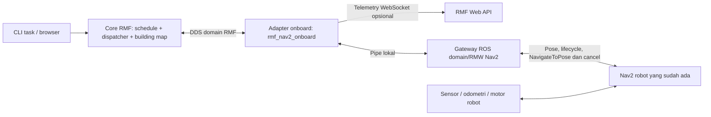

# Open-RMF + Nav2: modul onboarding robot fisik

Modul mandiri **ROS 2 Humble / Ubuntu 22.04** untuk menambahkan robot yang
sudah mempunyai Nav2 ke Open-RMF. Satu profil YAML menentukan identitas,
komunikasi, topic, frame, peta, dimensi dan kemampuan robot. Nama paket tidak
bergantung pada Husky, Devi, Clearpath atau jenis lidar/IMU tertentu.

Mulai dengan **Nav2 robot yang sudah bekerja**: map, lokalisasi, TF, scan,
odometri dan action `NavigateToPose`. Modul ini menghubungkan Nav2 tersebut
dengan task, traffic schedule dan telemetry Open-RMF. Driver sensor,
controller motor dan startup Nav2 tetap dikelola workspace robot.

Versi `0.1.0`: template yang dapat dibuild dan diuji; setiap robot baru tetap
memerlukan pengukuran dan commissioning fisik. Data robot yang belum diketahui
diberi `null` dan ditolak oleh validator. Jangan menyalin dimensi/kecepatan
robot lain atau menandai penerimaan sebelum uji selesai.

## 1. Pembagian perangkat dan batas dukungan



| Komponen | Komputer utama / laptop | Robot baru |
| --- | --- | --- |
| Core RMF | Satu core bersama | Tidak perlu core kedua |
| Web API/dashboard | Opsional; pakai server yang ada | WebSocket ke API bila dikonfigurasi |
| CLI task | Bisa di sini | Bisa juga di robot |
| Paket `rmf_nav2_onboard` | Untuk CLI; opsional untuk core baru | Adapter dan gateway lokal |
| Driver, lokalisasi, Nav2 | Tidak mengambil alih kendali lokal | Tetap dari underlay robot |
| Konfigurasi `robot.yaml` + aset | Salinan diperlukan untuk CLI/core | Profil operasional robot |

Yang didukung:

- Satu robot dan **satu fleet unik per proses adapter**. Robot tambahan memakai
  profil, nama robot, nama fleet dan service lain. Dua robot dengan fisik
  berbeda dapat berbagi core yang sama.
- Robot differential drive, satu lantai, task `patrol` ke waypoint bernama.
- Domain dan RMW RMF/Nav2 dapat sama atau berbeda. Contoh: RMF domain `0`
  Cyclone DDS dan Nav2 domain `73` Fast DDS.
- Konversi koordinat planar Nav2 ↔ RMF tanpa menerbitkan TF baru.
- BatteryState atau estimasi SoC dari voltase opsional.
- Kebijakan transit tanpa penyempurnaan yaw opsional, setelah konfigurasi
  Nav2 ditinjau; yaw ujung lintasan tetap diperiksa.

Belum didukung: docking/charging otomatis, lift/door automation, delivery
dengan dispenser, arm, multi-floor, kendaraan holonomic/Ackermann, atau
beberapa proses adapter yang sama-sama mengelola satu fleet. Fleet homogen
dengan beberapa robot perlu satu adapter yang mengelola seluruh anggota;
kontrak tersebut belum disediakan pada versi ini.

Modul tidak memasang atau menyalakan driver/Nav2, mengubah jaringan, mengubah
parameter motor/safety, atau memigrasikan service lama. Inspect/preflight
tidak membuat publisher velocity atau mengirim goal. `run --enable-dispatch`
mendaftarkan robot yang kemudian dapat menerima task, sehingga merupakan
tahap aktivasi operasional.

## 2. Struktur source dan command

```text
modular/                         # Atau root repository mandiri hasil bundle
  README.md
  docs/
    PARAMETERS.md                # Arti parameter, satuan dan sumber pengukuran
    NETWORKING.md                # LAN / Wi-Fi berbeda / jaringan routed
    VALIDATION.md                # Bukti uji dan batas hasil
  tools/robot.bash               # Semua command operator
  src/rmf_nav2_onboard/
    launch/core.launch.py        # Core opsional, bukan core tambahan
    rmf_nav2_onboard/
      templates/robot.yaml
      config.py                  # Validator, pin aset, transformasi
      gateway.py                 # Proses Nav2 dengan domain/RMW sendiri
      controller.py              # Urutan waypoint, result dan cancel
      runtime.py                 # Preflight + fleet adapter native Humble
      cli.py                     # Task CLI dan tool onboarding
      render.py                  # Template BT, parameter Nav2, systemd
    test/                        # Uji offline + opt-in ROS loopback
  robots/robot_01/               # Dibuat dengan command new
    robot.yaml
    assets.lock.json
    assets/                      # Aset canonical dari core
```

Semua command berikut dijalankan **dari folder `modular/`**, atau dari root
repository mandiri hasil ekspor. Gunakan `bash tools/robot.bash COMMAND --help`
untuk pilihan lengkap.

| Command | Fungsi | Efek runtime |
| --- | --- | --- |
| `new` | Membuat profil robot yang belum commissioned | Menulis profil baru saja |
| `pin-assets` | Mengunci hash graph/building/map/image | Menulis `assets.lock.json` |
| `validate` | Memeriksa konfigurasi dan hash aset | Offline |
| `waypoints` | Menampilkan tujuan bernama | Offline |
| `build` | Build paket lokal | Menulis build/install/log |
| `inspect` | Membaca Nav2, sensor dan TF | Tidak mengirim goal |
| `preflight` | Inspect + commissioning + profil/core RMF | Tidak mendaftarkan robot |
| `run --enable-dispatch` | Registrasi dan eksekusi task melalui Nav2 | Dapat menerima task gerak |
| `task` | Menampilkan JSON permintaan | Dry-run secara default |
| `task --send` | Mengirim satu permintaan task/cancel | Task gerak atau cancel sesuai argumen |
| `render-nav2` | Membuat fragmen parameter transit untuk ditinjau | Tidak mengubah Nav2 aktif |
| `render-service` | Membuat unit user systemd | Tidak memasang/menjalankan unit |
| `core` | Core baru opsional untuk instalasi tanpa core | Menjalankan tiga node core dan profil |
| `publish-profile` | Profil site untuk core non-BRIN | Publisher String 1 Hz, tanpa task |
| `bundle` | Mengekspor source mandiri | Tidak menyertakan profil/aset robot pribadi |

## 3. Prasyarat pada robot

Operator perlu mengetahui informasi berikut sebelum aktivasi:

1. Username/workspace robot, Ubuntu/ROS distro dan script setup underlay.
2. ROS domain, RMW, file DDS/discovery server yang dipakai Nav2.
3. Nama penuh action NavigateToPose, lifecycle node, topic map/scan/odom,
   topic TF dan frame `map`/`base_link` yang benar.
4. Dimensi footprint nyata serta kecepatan/akselerasi linear dan angular
   yang sudah diterima untuk robot ini.
5. Peta yang sedang dipakai, initial pose fisik benar, dan graph RMF yang
   sesuai. Nama lantai dan satu waypoint home harus ada pada graph.
6. Alamat core/Web, domain/RMW RMF, digest profil core, serta keselarasan
   koordinat Nav2–RMF.

Jika informasi tersebut belum ada, ambil melalui audit baca-saja sebelum
mengaktifkan adapter. [Referensi parameter](docs/PARAMETERS.md) menjelaskan
cara memperoleh nilainya.

Prasyarat paket berikut dapat dipasang **oleh operator di device yang
dituju**, setelah sumber apt ROS Humble tersedia:

```bash
sudo apt-get update
sudo apt-get install --no-install-recommends \
  python3-colcon-common-extensions python3-yaml python3-pytest \
  ros-humble-rmf-fleet-adapter-python \
  ros-humble-rmf-fleet-msgs ros-humble-rmf-task-msgs \
  ros-humble-rmw-cyclonedds-cpp ros-humble-rmw-fastrtps-cpp
```

Nav2, `rclpy`, TF2, nav/sensor/action/lifecycle messages harus sudah tersedia
dari instalasi Nav2 robot. Verifikasi setelah source underlay robot:

```bash
source /opt/ros/humble/setup.bash
# Ganti dengan underlay robot yang benar:
source /home/ROBOT_USER/nav2_ws/install/local_setup.bash
python3 -c 'import rclpy, rmf_adapter, nav2_msgs, tf2_ros; print("runtime imports OK")'
```

Pengguna custom-build RMF perlu source underlay RMF yang sesuai dan memakai
API Humble; jangan mencampur binary dari ROS distro lain. Script mendukung
`RMF_NAV2_UNDERLAY=/absolute/path/to/local_setup.bash` untuk satu underlay
tambahan. Bila robot memerlukan beberapa underlay, source urutannya di
terminal atau melalui setup khusus robot yang sudah ditinjau.

## 4. Membuat profil robot baru

Contoh robot baru `robot_01`, fleet `Robot01Fleet`, namespace `/robot_01`:

```bash
bash tools/robot.bash new \
  --name robot_01 --fleet Robot01Fleet --namespace /robot_01 \
  --robot-domain 73 --rmf-domain 0 --output robots/robot_01
```

Untuk Nav2 tanpa namespace, gunakan `--namespace /`. File yang sudah ada
tidak ditimpa. Edit profil hasil pembuatan:

```bash
nano robots/robot_01/robot.yaml
```

Isi seluruh `null` yang wajib: footprint/vicinity radius, empat batas motion,
home waypoint dan digest core. Humble mensyaratkan home vertex mempunyai
metadata `is_charger: true` pada graph canonical agar registrasi robot
berhasil. Label graph ini tidak mengaktifkan docking/charging; finishing
request tetap `nothing` dan battery drain planning dinonaktifkan.
Koreksi semua topic/frame/lifecycle dari
runtime robot; `new` hanya membuat nama awal berdasarkan namespace. Contoh
Nav2 sering memakai `/odom` alih-alih `/odometry/filtered`, atau TF privat.

Angka geometry/motion hanya dipakai RMF untuk profil traffic dan perencanaan.
Mengubahnya tidak mengubah batas controller Nav2. Nilainya harus konsisten
dengan footprint dan batas robot yang sudah diuji.

Untuk `battery.mode: none`, modul tidak menyuntikkan persentase baterai
buatan. RMF/Web dapat menampilkan nilai default/terakhir sampai baterai nyata
dikonfigurasi. Consumption-based planning dan charger travel dinonaktifkan;
konstanta battery/mechanical internal merupakan placeholder API planner,
bukan spesifikasi robot atau model energi yang telah dikalibrasi.

## 5. Menyiapkan aset site dan kecocokan core

Salin **aset canonical dari core/site yang sama** ke:

```text
robots/robot_01/assets/nav_graph.yaml
robots/robot_01/assets/site.building.yaml
robots/robot_01/assets/map.yaml
robots/robot_01/assets/map.pgm        # Atau PNG sesuai field image pada map.yaml
```

Gunakan byte aset yang sama pada core dan robot. Jangan menyalin seluruh
workspace/build/install. Pastikan `image:` di `map.yaml` mengarah ke gambar
yang ikut disalin. Nilai `nav2.map_yaml` harus menggambarkan **peta yang
benar-benar diload Nav2**. Perbedaan nama map, origin atau transformasi perlu
diselesaikan melalui kalibrasi, bukan sekadar mengganti digest.

Kunci file setelah peninjauan:

```bash
bash tools/robot.bash pin-assets --config robots/robot_01/robot.yaml
```

Command mencetak `own_core_site_digest` dan membuat `assets.lock.json`.
Hash mendeteksi perubahan aset lokal sejak penguncian; hash itu sendiri
tidak membuktikan ruangan dan lokalisasi fisik benar.

Ada dua pilihan core:

**A. Core BRIN yang sudah aktif, termasuk komputer-utama saat ini.**
Pertahankan core tersebut. Di terminal ROS komputer-utama dengan domain/RMW
integrasi yang benar, baca digest aktual:

```bash
timeout 8s ros2 topic echo /brin_hardware/profile_digest std_msgs/msg/String \
  --once --qos-durability transient_local
```

Masukkan nilai `data` pada `rmf.expected_profile_digest`, dan pertahankan
`rmf.profile_topic: /brin_hardware/profile_digest`. Digest BRIN mempunyai
algoritme bundle sendiri; **jangan menggantinya dengan** `own_core_site_digest`
atau menyalakan publisher kedua. Pin aset lokal tetap diperlukan.

**B. Instalasi mandiri yang belum mempunyai core.**
Gunakan `own_core_site_digest` dari aset canonical pada komputer utama untuk
`rmf.expected_profile_digest`. Pilih topic khusus, misalnya
`/rmf_nav2/site_digest`, pada profil core dan semua profil robot. Core opsional
di bagian 7 menerbitkannya 1 Hz. Digest hanya aset site, sehingga dimensi,
nama fleet dan motion setiap robot boleh berbeda.

Jika menghubungkan core non-BRIN yang sudah ada, pertahankan core itu dan
jalankan tepat satu `publish-profile` di komputer utama setelah memastikan
core benar-benar memakai aset yang sama. Jangan menjalankannya pada robot
untuk membuat preflight tampak lulus.

Lalu validasi offline dan lihat waypoint:

```bash
bash tools/robot.bash validate --config robots/robot_01/robot.yaml
bash tools/robot.bash waypoints --config robots/robot_01/robot.yaml
```

## 6. Build di setiap device

Di robot baru:

```bash
export RMF_NAV2_UNDERLAY=/home/ROBOT_USER/nav2_ws/install/local_setup.bash
bash tools/robot.bash build
```

Di komputer utama/laptop yang membutuhkan CLI, build source yang sama dengan
underlay perangkat tersebut. Jangan menggunakan path `/home/ROBOT_USER/...`
pada laptop; ganti sesuai setup lokal. Hasil build tetap lokal per perangkat.

Source paket ini tidak bergantung pada `husky/src`, `devi/src`, nama sensor
atau paket konfigurasi robot tertentu. Build hanya mencari `modular/src`,
sehingga tidak mengambil paket snapshot dengan nama ganda.

## 7. Menyiapkan komputer utama

Jika core lama sudah berjalan, **lewati pembuatan core baru**. Pastikan
schedule, dispatcher dan building map server memakai waktu nyata dan domain
RMF dari profil. RMF Web tetap memakai deployment yang sudah ada; modul tidak
memasang dashboard/API, autentikasi atau reverse proxy.

Hanya untuk instalasi mandiri tanpa core, pasang prasyarat tambahan core pada
komputer utama:

```bash
sudo apt-get install --no-install-recommends \
  ros-humble-rmf-traffic-ros2 ros-humble-rmf-task-ros2 \
  ros-humble-rmf-building-map-tools
bash tools/robot.bash core --config robots/robot_01/robot.yaml
```

Core opsional menolak node core yang sudah ditemukan sebelum startup.
Pemeriksaan discovery tidak menggantikan koordinasi operator jika dua core
dijalankan bersamaan pada komputer berbeda.

Untuk core non-BRIN yang sudah ada dan belum mempunyai publisher profil:

```bash
bash tools/robot.bash publish-profile --config robots/robot_01/robot.yaml
```

Jalankan command tersebut di komputer utama dengan aset canonical. URI Web
opsional pada robot berbentuk `ws://CORE_LAN_IP:8000/_internal` atau endpoint
`wss://...` yang disediakan deployment Web. `localhost` pada robot menunjuk
robot sendiri. Untuk jaringan berbeda, baca [NETWORKING.md](docs/NETWORKING.md).

## 8. Pemeriksaan robot tanpa gerak

Hidupkan sensor/lokalisasi/Nav2 menggunakan prosedur asli robot. Berikan
initial pose melalui prosedur robot yang sudah bekerja. Jangan menjalankan
bringup sensor/Nav2 kedua.

```bash
bash tools/robot.bash inspect --config robots/robot_01/robot.yaml --timeout 20
```

Inspect harus menampilkan `nav2_ready: true`. Ia membaca map/scan/odom,
kesegaran TF, lifecycle aktif, `use_sim_time: false` dan satu action server.
`accepted: false` pada inspect memang disengaja: inspect tidak memberi izin
dispatch dan tidak mendaftarkan robot.

Konfirmasikan footprint, keselarasan peta, uji Nav2 fisik dan prosedur stop
sesuai robot. Setelah penerimaan selesai, ubah empat flag `commissioning`
menjadi `true`, kemudian:

```bash
bash tools/robot.bash validate --config robots/robot_01/robot.yaml --commissioned
bash tools/robot.bash preflight --config robots/robot_01/robot.yaml --timeout 20
```

Hasil yang diperlukan: `accepted: true`, `errors: []`, `goals_sent: 0`,
`robot_registered: false`. Kegagalan mempunyai exit code `2`; baca JSON dan
perbaiki penyebabnya. Preflight tidak melewati error dengan flag paksa.

## 9. Mengaktifkan adapter dan memberikan task

Di robot, dengan area uji dan operator siap:

```bash
bash tools/robot.bash run --config robots/robot_01/robot.yaml --enable-dispatch
```

Adapter mengulang preflight runtime, melakukan handshake schedule native,
lalu mendaftarkan satu robot. Tunggu log `Registered robot_01 in Robot01Fleet`.
Tidak perlu adapter kedua ketika service sudah aktif.

Di komputer utama/laptop dengan salinan profil/aset yang sama, gunakan
waypoint nyata dari output `waypoints`. Contoh berikut mengasumsikan ada
waypoint bernama `station_01`:

```bash
# Dry-run: menampilkan payload, tidak membuat ROS publisher.
bash tools/robot.bash task --config robots/robot_01/robot.yaml \
  --places station_01

# Mengirim task satu kali; ini dapat menggerakkan robot.
bash tools/robot.bash task --config robots/robot_01/robot.yaml \
  --places station_01 --send --timeout 30

# Patrol beberapa tujuan, satu round.
bash tools/robot.bash task --config robots/robot_01/robot.yaml \
  --places station_01 home --rounds 1 --send --timeout 30

# Gunakan ID booking dari respons, bukan request_id.
bash tools/robot.bash task --config robots/robot_01/robot.yaml \
  --cancel patrol.dispatch-EXAMPLE --send --timeout 20
```

Respons sukses berarti permintaan diterima; **bukan task sudah selesai**.
Pantau `/fleet_states`, task state pada Web dan log adapter. Task CLI tidak
mengulang permintaan otomatis ketika timeout: periksa `request_id` sebelum
mengirim ulang supaya task tidak dibuat dua kali.

Untuk Web, `rmf.web_uri` mengaktifkan telemetry adapter menuju API yang sudah
berjalan. Form/dashboard yang mengunci daftar fleet/robot pada source perlu
ditambah nama fleet/robot baru melalui deployment Web tersebut. Modul tidak
menjanjikan dashboard lama mengenali robot baru tanpa penyesuaian form.

## 10. Transit tanpa koreksi yaw setiap vertex

Pilihan ini default **false** untuk robot baru sampai Nav2 ditinjau. Isi
`nav2.transit_xy_tolerance` dengan toleransi XY goal checker robot, dan pastikan
`planner_id`/`controller_id` sesuai plugin yang terpasang.

```bash
bash tools/robot.bash render-nav2 --config robots/robot_01/robot.yaml \
  --output robots/robot_01/nav2_transit.fragment.yaml
```

Operator meninjau dan memuat fragmen itu melalui konfigurasi launch Nav2
robot yang sebenarnya. Renderer tidak mengedit file aktif. Fragmen harus
ikut dalam file parameter yang diterima node BT internal; wrapper Nav2 yang
hanya meneruskan parameter node induk perlu disesuaikan oleh pemiliknya.
Setelah restart Nav2 terkoordinasi dan review parameter selesai, isi:

```yaml
nav2:
  final_orientation_only: true
  transit_xy_tolerance: 0.20  # Contoh; pakai toleransi asli robot.
  transit_params_confirmed: true
```

Kemudian ulangi preflight dan restart **adapter tunggal** saat task selesai.
Log transit menampilkan `(position only)` dan ujung lintasan `(position and yaw)`.
Hold jadwal RMF tetap dipertahankan; ini dapat membatasi pengurangan waktu
meskipun koreksi yaw berkurang. Akhir lintasan RMF bisa mendahului akhir task
karena replan/event. Putaran untuk tikungan atau recovery tujuan akhir masih
dapat diperlukan. AMCL tetap berjalan sepanjang perjalanan.

## 11. Startup otomatis opsional

Selesaikan uji foreground lebih dulu, kemudian render unit khusus robot:

```bash
bash tools/robot.bash render-service --config robots/robot_01/robot.yaml \
  --workspace "$PWD" \
  --underlay /home/ROBOT_USER/nav2_ws/install/local_setup.bash \
  --output robots/robot_01/rmf-nav2-robot_01.service
```

Tinjau unit, tutup adapter foreground dengan Ctrl-C dan tunggu shutdown.
Pasang dari terminal user robot, bukan sebagai service system-level root:

```bash
install -D -m 0644 robots/robot_01/rmf-nav2-robot_01.service \
  "$HOME/.config/systemd/user/rmf-nav2-robot_01.service"
systemctl --user daemon-reload
systemctl --user enable --now rmf-nav2-robot_01.service
systemctl --user status rmf-nav2-robot_01.service --no-pager -l
journalctl --user -u rmf-nav2-robot_01.service -f
```

Service hanya menjalankan adapter/gateway dan menunggu readiness. Startup
sensor/Nav2 tetap milik robot. Untuk jalan tanpa sesi login, operator dapat
menyetujui `sudo loginctl enable-linger ROBOT_USER`; modul tidak mengubahnya.

Menonaktifkan integrasi robot ini:

```bash
systemctl --user disable --now rmf-nav2-robot_01.service
```

Shutdown meminta cancel hanya untuk goal milik adapter. Task yang terputus
tidak ditandai sukses. Driver/motor robot harus tetap menyediakan prosedur
stop fisik sendiri; Ctrl-C/putus SSH bukan pengganti E-stop.

## 12. Menambahkan robot kedua

Buat profil lain, misalnya `robot_02` / `Robot02Fleet`, lalu ulangi langkah
4–11 dengan topic/domain/dimensi robot tersebut. Salin aset site yang sama,
pakai digest core yang sama dan koreksi alignment masing-masing. Jangan
menjalankan core baru untuk setiap robot.

Jika robot berbeda fisik, tidak cukup mengganti `robot.name`: ukur footprint,
isi motion, audit lifecycle/TF/topic dan commissioning robot kedua. Jika
beberapa robot berbagi domain Nav2 yang sama, namespace action/topic/frame
mereka harus terpisah pada bringup asli agar tidak saling mengendalikan.

## 13. GitHub, ekspor mandiri dan update

Pada repository `rmf-integration`, source baru berada seluruhnya di `modular/`.
Review sebelum commit:

```bash
git status --short modular
git diff --check
git add modular
git commit -m "Add modular onboard Open-RMF Nav2 integration"
```

Jangan menambahkan log, build/install, key, `.env`, atau aset peta privat tanpa
review. `.gitignore` tidak dapat menjamin semua konfigurasi pribadi tersaring;
periksa setiap profil yang hendak dipublikasikan.

Untuk repository GitHub terpisah:

```bash
bash tools/robot.bash bundle --output /tmp/rmf-nav2-modular-0.1.0.tar.xz
mkdir -p /tmp/rmf-nav2-github
tar -xJf /tmp/rmf-nav2-modular-0.1.0.tar.xz -C /tmp/rmf-nav2-github
cd /tmp/rmf-nav2-github/rmf-nav2-modular
git init -b main
git add README.md LICENSE docs src tools .github .gitignore
git commit -m "Initial modular RMF Nav2 onboard integration"
git remote add origin git@github.com:YOUR_ACCOUNT/rmf-nav2-modular.git
git push -u origin main
```

Ganti `YOUR_ACCOUNT` dan buat repository tujuan melalui akun GitHub Anda.
`bundle` tidak menyertakan `robots/`, build/install/log atau hidden credentials.
Script menolak menimpa archive yang sudah ada. Contoh Git di atas merupakan
langkah operator; pembuatan modul tidak otomatis melakukan push/deployment.

Saat update: selesaikan/cancel task, catat commit lama, hentikan adapter,
checkout commit baru pada robot, build lokal, validasi/preflight lalu jalankan
satu adapter. Simpan profil robot terpisah dari perubahan library. Rollback
menggunakan commit sebelumnya dan build ulang; jangan menyalin `install` dari
laptop ke robot.

## 14. Pengujian dan diagnosis

```bash
PYTHONPATH=src/rmf_nav2_onboard PYTEST_DISABLE_PLUGIN_AUTOLOAD=1 \
  python3 -m pytest -q src/rmf_nav2_onboard/test
```

Tes offline tidak perlu ROS/network. Tes ROS nyata bersifat opt-in dan memakai
Nav2 tiruan di loopback/domain 221 serta core uji di 222. Petunjuk dan batas
verifikasi ada di [VALIDATION.md](docs/VALIDATION.md).

| Gejala | Periksa |
| --- | --- |
| `Missing asset` | Path relatif dihitung dari direktori `robot.yaml`, bukan cwd |
| `Asset lock mismatch` | Aset berubah; bandingkan dengan core sebelum pin ulang |
| `No data` / stale scan/odom | Topic, domain/RMW Nav2, timestamp waktu nyata, QoS |
| TF hilang/stale | Topic TF privat, frame asli dan lokalisasi yang benar |
| Lifecycle belum aktif | Node/namespace tepat dan Nav2/lokalisasi selesai startup |
| Action server 0 atau lebih dari 1 | Domain/action salah atau bringup ganda |
| Profile mismatch | Digest/topic/domain RMF, DDS/VPN, hanya satu publisher core |
| Preflight lolos, handshake RMF gagal | Versi RMF native, koneksi DDS dua arah, source underlay |
| Robot terlalu jauh dari graph | Pose, alignment dan graph yang dipakai; jangan membesarkan batas sembarang |
| Native import gagal | Source ROS/RMF sesuai distro sebelum build/run |
| Task timeout | Cek request_id dan status task sebelum resubmit |
| Robot terdaftar tetapi Web tidak ada | URI internal Web, API LAN, daftar fleet pada dashboard |

Laporkan output `validate`, JSON inspect/preflight, commit source, versi paket
RMF/Nav2 dan log service saat meminta diagnosis. Jangan membagikan password,
private key atau token API.
